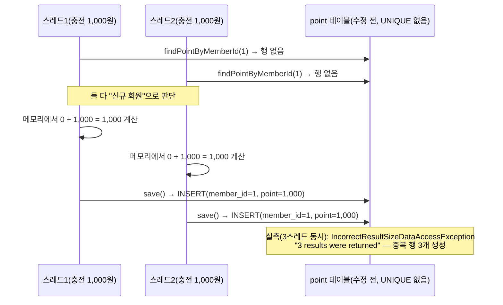
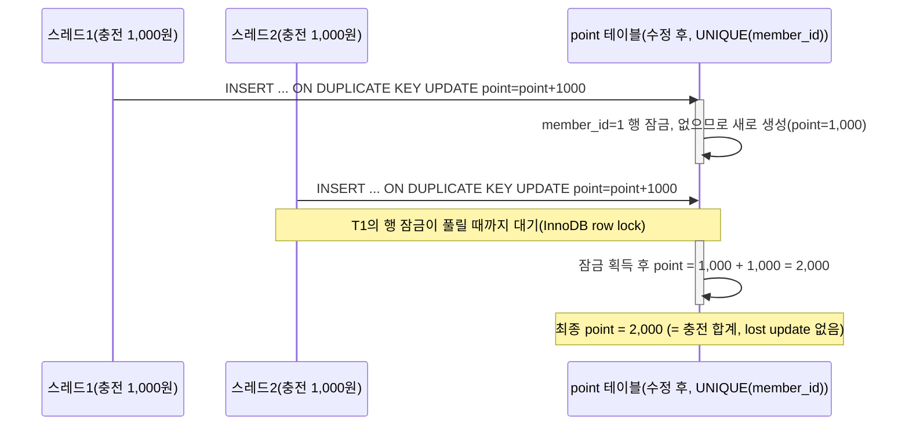
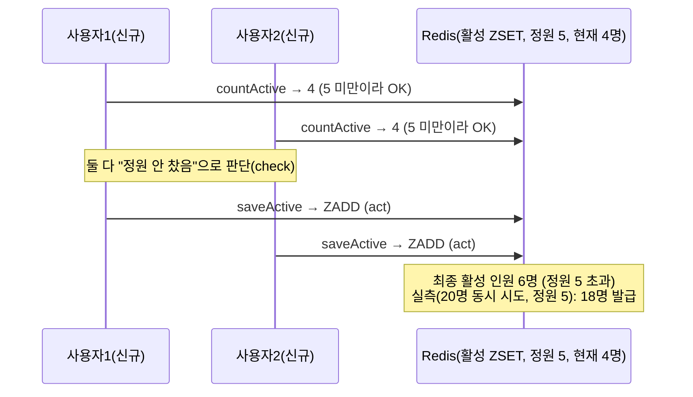
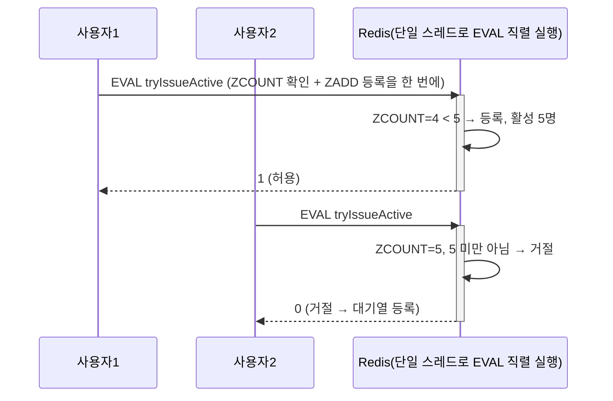
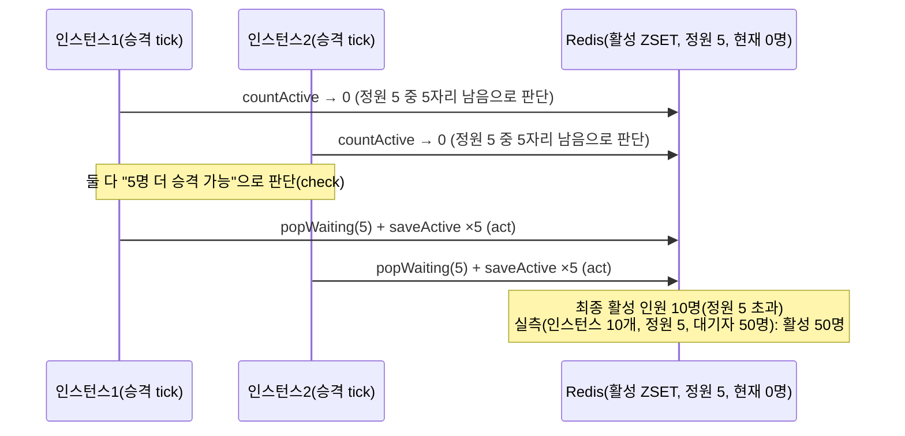
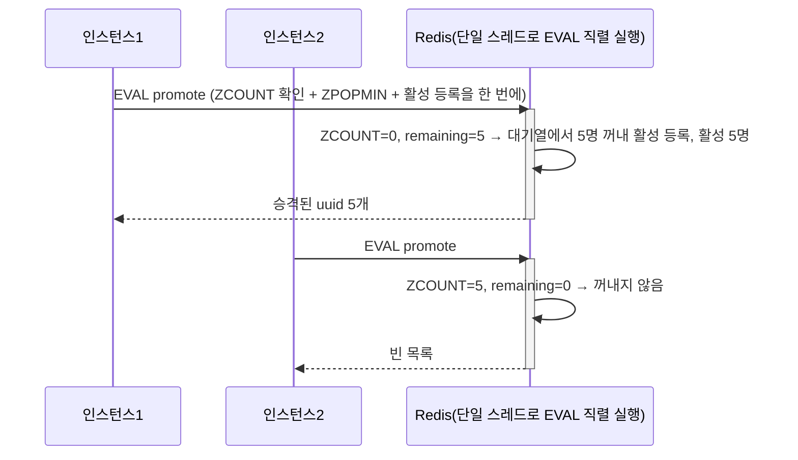
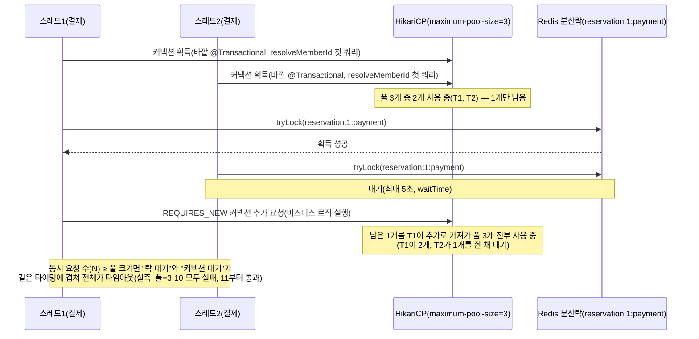

# Step 4 선택 심화 ② 기능별 동시성 테스트 보고서

> 동시성 테스트의 목적은 "통과"가 아니라 "어떤 기능이 경합에 예민한지 미리 리스트업하고, 그 리스트업을
> 하나도 빠짐없이 테스트로 Rule에 가두는 것"이다. 위험도 상 3건(이전 세션)과, 사용자 결정으로 범위에
> 포함한 대기열 승격 멀티 인스턴스 경합(이번 추가 보완, 원래는 "중")까지 총 4건을 실제로
> 고쳤고(RED→GREEN 실측), 나머지 중·하 등급과 이번에 새로 찾은 리프레시 토큰 경합은 고치지 않되
> **현재 동작을 테스트로 고정**했다. 모든 수치는 `./gradlew test`로 실제 실행해 측정했고, 측정하지
> 않은 수치는 적지 않았다.

---

## 0. 한눈에 보기

### 과제 요구사항 충족표

| 요구사항(원문 문구 단위) | 이 보고서의 답 | 위치 |
|---|---|---|
| 어떤 기능이 동시성 이슈에 예민할지 **리스트업** | 좌석·결제·만료 스케줄러·포인트·대기열(발급/승격/만료/반납)·토큰 검증·회원가입·인증까지 전체 쓰기 경로를 훑어 **17개 행**으로 리스트업(완료 5 · 상 6 · 중 3 · 하 3) | §3 |
| 리스트업한 것을 **테스트로 작성** | 위험도 상 3건 + 이번에 범위로 끌어온 중 1건(대기열 승격, ADR-7)까지 총 4건은 RED→수정→GREEN 실측, 나머지 중·하 5건(그중 2건은 이번에 새로 찾음)은 현재 동작을 고정하는 테스트 추가 | §4, §5 |
| 테스트로 **Rule에 가두기** | 17개 행 중 16개 행이 테스트에 연결됨. #17(로그인 signIn 시 리프레시 토큰 덮어쓰기)은 멀티 디바이스 정책이 미정이라 별도 테스트 없이 리스트업만 함 | §6 |

### 핵심 결과 표 (실측)

| 경합 | 수정 전(RED 실측) | 수정 후(GREEN 실측) | 지키는 테스트 |
|---|---|---|---|
| 포인트 신규 최초 충전(동시 3스레드) | `IncorrectResultSizeDataAccessException`(중복 행 3개 생성) | 15,000원 정확 일치 | `PointConcurrencyIntegrationTest` |
| 포인트 차감(다른 예약 2건 동시 결제) | 재현 안 됨(3회 시도) — 그래도 조건부 UPDATE로 수정 | 항상 안전(코드상 보장) | `PointConcurrencyIntegrationTest` |
| 포인트 충전+차감 **혼합** 동시(이번 보완) | (기존 수정 범위로 이미 방어) | `765,000`원(1,000,000+15×1,000−5×50,000) 정확 일치 | `PointConcurrencyIntegrationTest` |
| 결제 멱등성(락 우회, 순차 2회) | 중복 결제 허용(예외 없음) | `DuplicatePaymentException` | `PaymentIdempotencyConcurrencyIntegrationTest` |
| 결제 멱등성(락 우회, 10 동시) | `expected:<1> but was:<10>` | 1건만 성공, 9건 예외 | `PaymentIdempotencyConcurrencyIntegrationTest` |
| 대기열 발급 정원(정원 5, 신규 20명) | `expected:<5> but was:<18>` | 정확히 5명 | `QueueCapacityConcurrencyIntegrationTest` |
| **대기열 승격 멀티 인스턴스**(정원 5, 인스턴스 10, 이번 추가 보완) | `expected:<5L> but was:<50L>`(check-then-act, 정원의 10배 승격) | 정확히 5명(`ActiveQueueRepository.promote` Lua EVAL로 원자화, ADR-7) | `QueueTokenLifecycleConcurrencyIntegrationTest` |
| **리프레시 토큰 동시 회전**(이번 신규 발견) | **미수정 — 실측: 2건 모두 성공, 그중 하나는 저장되지 않는 유령 토큰** | 동일(위험 인지, 사용자 결정: 기록만 하고 나중에 처리 — ADR-6) | `RefreshTokenRotationConcurrencyIntegrationTest` |

---

## 1. 배경과 목표

필수 ①②③(좌석 예약·결제·만료 해제)은 이미 분산락 + 조건부 UPDATE + Redis Lua로 방어돼 있다. 이번
선택 심화 ②의 범위는 그 바깥이다 — **포인트, 결제 멱등성, 대기열 정원**(상), **대기열 승격·토큰
반납/검증/만료, 회원가입, 인증(리프레시 토큰)**(중·하)까지 쓰기 경로 전체를 다시 훑어 "경합 후보
빠짐없이 찾기 → 실측 → 테스트로 고정"을 완성한다.

이전 세션(2026-10-21)에서 위험도 "상" 3건은 이미 고쳤다. 이번 보완 세션의 목표는 두 가지다.

1. **리스트업 재점검**: 이미 다른 테스트가 지키고 있는 영역(좌석, 결제-만료 경합)도 표에 포함해
   전체 그림을 완성하고, 빠진 경합 후보(대기열 승격/반납/만료, 리프레시 토큰)를 추가로 찾는다.
2. **테스트 없는 항목을 테스트로 채운다** — 고치지 않기로 한 위험(중·하)도 "현재 동작"을 테스트로
   고정해, 나중에 누군가 실수로 더 나쁘게 바꾸면 테스트가 걸리도록 만든다.

**이번 보완 세션에서 프로덕션 코드는 변경하지 않았다** — 테스트 5개(신규 파일 2개 + 기존 파일 1개에
1개 추가)와 이 보고서만 변경했다. 위험도 상 3건의 프로덕션 수정은 이전 세션 것 그대로다(§4, §7).

---

## 2. 실험 설계

재현 방법론은 이전 세션과 동일한 원칙을 유지했다.

- **RED 재현**: 위험도 "상" 3건은 `git stash`로 수정 전 프로덕션 코드를 실제로 복원해 측정했다(추측
  아님). 이번 보완 세션에서 추가한 항목(승격/반납/만료/리프레시 토큰)은 애초에 수정하지 않기로
  했으므로 "RED"가 곧 "현재 코드의 실측값"이다 — 별도로 되돌릴 필요가 없다.
- **출발선 래치**: 모든 동시성 테스트는 `CountDownLatch` 기반 출발선 패턴
  (`runConcurrently`/`runConcurrentlyCollecting`, `src/test/java/kr/hhplus/be/server/support/ConcurrencyTestSupport.kt`)으로
  스레드를 동시에 출발시킨다.
- **스레드 수**: 클래스별 10~20 (대기열 승격 테스트는 "인스턴스" 10개 × 대기자 50명).
- **락 경유 여부**: 위험도 "상"의 결제 멱등성 테스트는 "락을 경유"(직렬화됨, 재현 안 됨)와 "락을
  우회해 저장소를 직접 두드림"(DB 단독 방어선 검증) 두 경로를 모두 측정했다.
- **반복**: 타이밍에 의존하는 레이스(대기열 반납-vs-검증, 만료-vs-발급 북키핑)는 1회만으로는
  두 분기를 다 보장할 수 없어 각각 50회·100회 반복하고 분포를 실측했다.
- **완료 기준**: `./gradlew test`(기본, perf 태그 제외) 전체 통과 + 각 신규 테스트의 println 실측값을
  이 보고서에 그대로 옮긴다. 플레이키 방지를 위해 모든 저장소 호출에 타임아웃(30초 await)을 둔다.
- **재현 명령**:
  ```bash
  ./gradlew test --tests "kr.hhplus.be.server.concurrency.*"
  ./gradlew clean test   # 전체 회귀
  ```

---

## 3. 리스트업 — 쓰기 경로 전체 재점검

> "현재 방어선" 열의 "완료"는 필수 ①②③ 또는 이전 세션에서 이미 고친 것, "이번 보완"은 이번
> 세션에서 새로 테스트를 추가한 것이다.

| # | 기능 | 경합 시나리오 | 현재 방어선 | 위험도 | 근거(돈·재고·정원 영향, 발생 조건) | 조치 | 테스트 |
|---|---|---|---|:---:|---|---|---|
| 1 | 좌석 예약(홀드) | 같은 좌석 N명 동시 요청 | 분산락(`schedule:{id}:seat-reservation`) + 조건부 UPDATE(`holdAvailableSeats`) | — | 완료(필수 ③) | 완료 | `ConcurrentSeatReservationIntegrationTest` |
| 2 | 좌석 예약(홀드), 락 우회 | 분산락 없이 트랜잭션 여러 개가 같은 좌석을 동시 홀드 | DB 조건부 UPDATE(`status='AVAILABLE'`)가 최후 방어선 | — | 완료 | 완료 | `SeatRepositoryIntegrationTest`(`분산락 없이 여러 트랜잭션이 동시에 같은 좌석을 홀드해도 DB가 한 건만 허용한다`) |
| 3 | 결제 확정 vs 홀드 만료 스케줄러 | 결제 확정과 만료 스케줄러가 동시에 같은 좌석을 건드림(TOCTOU) | `confirmHeldSeats`(`HOLD` + `reservation_id` 조건부 UPDATE) — `2026-10-20-g-fix-review.md` CRITICAL 1 수정 | — | 완료 | 완료 | `SeatRepositoryIntegrationTest`(`만료 처리로 이미 풀린 좌석은 결제 확정되지 않는다`, `다른 예약이 잡은 좌석은 결제 확정되지 않는다`) |
| 4 | 좌석 홀드 만료 정리 vs 재홀드(ABA) | 만료 처리가 좌석 ID만으로 Redis를 지우다 막 재홀드된 항목까지 지움 | `REMOVE_EXPIRED_SCRIPT`(ZSCORE ≤ now인 것만 CAS 삭제) — 같은 리뷰 CRITICAL 2 수정 | — | 완료 | 완료 | `SeatHoldRedisRepositoryIntegrationTest` |
| 5 | 결제 완료 vs 만료 처리 중복 정리 | 결제가 끝난 좌석에 만료 큐 항목이 뒤늦게 남아 있을 때 만료 처리가 끼어듦 | afterCommit 정리 + `WHERE status='HOLD'` 조건 | — | 완료 | 완료 | `PaymentFailureRollbackIntegrationTest`(`결제가 끝난 좌석에 만료 항목이 남아 있어도 만료 처리는 좌석을 되돌리지 않는다`) |
| 6 | **포인트 충전** | 같은 회원이 동시에 N번 충전(신규 회원 최초 충전 포함) | 없음(원본) → `chargePoint` UPSERT(수정) | **상** | 돈(잔액) 직접 영향. 신규 회원 동시 충전 시 중복 행까지 생성됨(실측) | **수정함**(이전 세션) | `PointConcurrencyIntegrationTest` |
| 7 | **포인트 차감(결제)** | 같은 회원의 다른 예약 2건을 동시에 결제 | 분산락이 예약 단위라 보호 안 됨(원본) → `usePoint` 조건부 UPDATE(수정) | **상** | 돈(잔액) 직접 영향 | **수정함**(이전 세션) | `PointConcurrencyIntegrationTest` |
| 8 | 포인트 충전+차감 **혼합**(이번 보완) | 같은 회원이 충전(+)과 결제 차감(−)을 동시에 수행 | #6·#7과 같은 UPSERT/조건부 UPDATE — 혼합 시나리오는 이번에 처음 테스트 | **상**(기존 수정 범위) | 돈(잔액) 직접 영향 | 기존 수정으로 이미 방어됨, 이번에 **테스트로 실측 확인**만 추가 | `PointConcurrencyIntegrationTest`(신규) |
| 9 | **결제 멱등성** | 같은 예약을 동시에 여러 번 결제 | 분산락(커밋 후 해제) + `findByReservationId`(원본, DB UNIQUE 없음) → `payment.reservation_id` UNIQUE(수정) | **상** | 결제 중복 생성 = 환불 필요 장애 | **수정함**(이전 세션) | `PaymentIdempotencyConcurrencyIntegrationTest` |
| 10 | **대기열 토큰 발급 정원** | 정원 바로 아래에서 여러 명이 동시 발급 시도 | `countActive`→`saveActive`(원본, check-then-act) → `tryIssueActive` Lua(수정) | **상** | 정원은 서버 보호용 트래픽 제한의 핵심 약속 | **수정함**(이전 세션) | `QueueCapacityConcurrencyIntegrationTest` |
| 11 | 대기열 토큰 발급 중복(같은 회원) | 같은 회원이 토큰을 동시에 두 번 요청(재시도, 멀티 탭) | #10과 같은 Lua 원자화로 부수적으로 해결 | **상**(부수 해결) | 활성 인원 중복 집계 방지 | **수정함**(이전 세션) | `QueueCapacityConcurrencyIntegrationTest` |
| 12 | 회원가입 loginId 중복 | 같은 loginId로 동시 가입 | `findByLoginId` 중복 검사(check-then-act) + DB UNIQUE | **중** | 중복 **행**은 안 생김(UNIQUE가 막음). 패자가 도메인 예외 대신 `DataIntegrityViolationException`(HTTP 500)을 받음 — UX 품질 문제, 돈·재고 영향 없음 | 현재 동작 고정 | `MemberLoginIdConcurrencyIntegrationTest` |
| 13 | **대기열 승격 멀티 인스턴스**(이번 추가 보완) | 여러 서버 인스턴스의 스케줄러가 동시에 같은 스케줄을 승격 | `countActive`→`saveActive`(check-then-act, 원자화 안 됨) → `ActiveQueueRepository.promote` Lua EVAL(수정, ADR-7) | **중**(발생 시 정원 영향은 직접적이라 "상"에 준함) | 정원 초과 승격 가능. 현재 배포는 단일 인스턴스라 당장 위험은 낮지만, 멀티 인스턴스로 스케일하면 실제로 발생 — **RED 실측: 정원 5인데 활성 50명(10배)** | **수정함**(이번 추가 보완) — **GREEN 실측: 정확히 정원(5명)** | `QueueTokenLifecycleConcurrencyIntegrationTest` |
| 14 | 대기열 토큰 반납 vs 검증(이번 보완) | 결제 완료로 토큰이 반납되는 순간, 다른 탭의 좌석 조회가 토큰을 검증 | 없음(동기화 없음) | **하** | 돈·재고 영향 없음. 최악의 경우 그 순간의 요청 1건이 "토큰 무효"로 거절되고 재발급하면 해결 | 현재 동작 고정 — **실측: 50회 중 검증 성공 16 / 거절 34, 둘 다 정상 분기** | `QueueTokenLifecycleConcurrencyIntegrationTest` |
| 15 | 대기열 만료 정리 vs 신규 발급 북키핑(이번 보완, **새로 발견**) | `removeExpiredActive`가 "정리→스케줄 집합에서 제거"를 비원자적 2단계로 수행, 그 사이 신규 발급이 끼면 방금 추가된 scheduleId를 다시 지울 수 있음 | 없음 | **하** | 돈·재고 영향 없음. 스케줄 북키핑 집합만 일시적으로 어긋나 다음 신규 발급 전까지 그 스케줄의 만료·승격 처리가 누락될 수 있음(활성 데이터 자체는 안 깨짐) | 현재 동작 고정 — **실측: 100회 반복 중 재현 0회**(§5, §9) | `QueueTokenLifecycleConcurrencyIntegrationTest` |
| 16 | **리프레시 토큰 동시 회전**(이번 보완, **새로 발견**) | 같은 refreshToken으로 동시에 두 번 갱신(네트워크 재시도, 중복 탭) | `find`→비교→`save`(check-then-act, 회원당 Redis key 1개, 락 없음) | **중**(세션 영향) | 돈·재고 영향 없음. 로그인 세션에는 영향 — 이긴 쪽만 유효한 새 토큰을 갖고, 진 쪽은 방금 받은 토큰이 무효화돼 재로그인해야 함 | 현재 동작 고정(위험 인지, **사용자 결정: 기록만 하고 나중에 처리** — ADR-6) — **실측: 2건 모두 성공, 한쪽 유령화** | `RefreshTokenRotationConcurrencyIntegrationTest` |
| 17 | 로그인(signIn) 시 리프레시 토큰 덮어쓰기 | 같은 사용자가 여러 기기/탭에서 동시 로그인 | #16과 같은 저장 메커니즘(회원당 key 1개, 마지막 쓰기가 남음) | 하 | "마지막 로그인한 기기만 유효"가 의도된 정책일 수도 있어(멀티 디바이스 정책 미정) 리스트업만 함 — 별도 테스트 없음 | 리스트업만(사용자 결정 필요 — §5) | — |

**리스트업 변경 요약**: 기존 10행(완료 2 + 상 3 + 부수해결 1 + 중 1 + 리스트업만 2)에서 **17행**으로
확장했다. 이번에 새로 추가한 것은 #2·#4·#5(이미 다른 테스트가 지키고 있었지만 표에 없었던 것),
#8(혼합 시나리오), #13·#14·#15(테스트 없이 리스트업만 돼 있던 것에 테스트 추가), #16·#17(전면
재점검 중 새로 발견).

---

## 4. 항목별 분석 — 위험도 "상" (수정 완료, 이전 세션)

### 4.1 포인트 충전/차감 — lost update, 그리고 발견한 또 다른 버그

**재현 테스트**: `src/test/java/kr/hhplus/be/server/concurrency/PointConcurrencyIntegrationTest.kt`

#### 문제 / 원인



| 단계 | 코드 상태 | 실측 결과 |
|---|---|---|
| RED(원본) | `find → 메모리 계산 → save()`, 분산락 없음, UNIQUE 없음 | **`IncorrectResultSizeDataAccessException`: 3 results were returned** — 중복 행 3개 생성 |
| 중간 수정(1차 시도) | 조건부 UPDATE 추가 + UNIQUE 위반 시 같은 트랜잭션에서 재시도 | **`expected:<15000> but was:<13000>`** — 충전 2건(2,000원) 소실 |
| GREEN(최종) | `INSERT ... ON DUPLICATE KEY UPDATE` 네이티브 UPSERT 한 문장 | **15,000원 정확 일치**(3회 재실행 모두 통과) |

**중간 수정이 실패한 원인(실측)**: Hibernate는 `save()`가 제약 위반으로 실패하면, 애플리케이션이
예외를 catch해도 같은 트랜잭션·같은 EntityManager로는 더 이상 안전하게 flush할 수 없는 상태로 만든다.
재시도한 조건부 UPDATE는 겉보기엔 실행됐지만 커밋 시점에 조용히 롤백됐다(테스트는 예외 없이 끝났지만
DB에 반영 안 됨). **"insert 실패 → catch → 같은 트랜잭션에서 재시도"는 일반적으로 위험하다** — 최종
해결은 재시도를 없애고 DB 레벨 UPSERT로 바꾸는 것이었다.

#### 해결



- `PointRepository.chargePoint`/`usePoint` 추가, `SpringPointJpa`가 네이티브 UPSERT/조건부 UPDATE로 구현.
- `PointEntity.memberId`에 UNIQUE 추가(회원당 포인트 행 1개 보장), 중복 인덱스(`idx_member_id`) 제거.
- `ChargePointService`/`ProcessPaymentService.processPointUsage`는 더 이상 도메인 모델을 메모리에서
  mutate하지 않고 저장소의 원자적 연산에 위임한다. 차감 쪽은 사전 검증(빠른 실패) + 조건부 UPDATE(최후
  방어선)를 모두 유지한다.

#### 결과(RED → GREEN) — 다른 예약 2건 동시 결제

| 단계 | 실측 결과 |
|---|---|
| RED 시도(원본, 3회 반복) | 재현 안 됨 — 3번 모두 정상 차감 |
| GREEN(수정 후) | 정상 통과 |

재현되지 않은 것은 "안전하다"는 뜻이 아니라 "이 테스트 규모로는 못 잡았다"는 뜻이다 — 분산락이
예약 단위라 두 결제가 코드상 전혀 직렬화되지 않는다는 사실은 변하지 않으므로, 수정은 재현 여부와
무관하게 적용했다.

#### 결과(이번 보완) — 충전+차감 혼합 동시 실행

같은 회원에게 충전 15회(×1,000원)와 결제 5건(×50,000원)을 동시에 실행했다. 초기 잔액
1,000,000원 기준 기대값은 `1,000,000 + 15,000 − 250,000 = 765,000`원이고, **실측값도 정확히
765,000원**이었다(`PointConcurrencyIntegrationTest`, 신규). 충전(UPSERT)과 차감(조건부 UPDATE)이
결국 같은 `point` 행에 대한 InnoDB 행 잠금으로 직렬화되므로, 두 연산이 뒤섞여도 순서와 무관하게
정확하다는 것을 실측으로 확인했다.

#### 트레이드오프

분산락으로 회원 단위(`member:{id}:point`) 락을 추가로 거는 방법도 가능했지만, (1) 결제 흐름에 락이
하나 더 늘어 데드락 순서 관리가 복잡해지고, (2) DB 조건부 UPDATE가 이미 "DB가 최후 방어선"이라는
Step4 원칙과 직접 맞아 더 적합하다고 판단했다. 대신 **"원자적 조건부 UPDATE만으로는 부족할 수
있다"**는 교훈을 얻었다 — 1차 수정(재시도)이 오히려 또 다른 lost update(13,000 vs 15,000)를 만들었고,
"고쳤다고 생각한 코드도 실제로 동시성 테스트로 다시 돌려봐야 한다"는 것을 실측으로 보여준 사례다.

**새 UNIQUE 제약(`point.member_id`)의 운영 반영 주의**: prod는 `ddl-auto: update`인데, 이 모드는
제약 추가는 시도하지만 기존 중복 데이터를 정리해주지는 않는다. 이 PR이 고치는 버그 자체가 "동시
최초 충전 시 중복 행 생성"이므로, 운영 DB에 이미 중복이 있을 가능성이 있다(실측 아님, 운영 접근
권한 없어 미확인). 배포 전 점검 쿼리와 정리 절차는 §8에 그대로 유지한다.

---

### 4.2 결제 멱등성 — 락은 이미 보호하지만, DB 단독 방어선은 없었다

**재현 테스트**: `PaymentIdempotencyConcurrencyIntegrationTest.kt` (테스트 3개)

| 테스트 | 경로 | RED(원본) | GREEN(수정 후) |
|---|---|---|---|
| 같은 예약을 분산락 경유로 동시에 N번 결제 | Facade 전체(락 포함) | 재현 안 됨 — 1성공 + 나머지 `DuplicatePaymentException`(정상) | 동일(변화 없음, 락이 원래도 보호) |
| 락 없이 저장소를 순차 2번 호출 | `paymentRepository.save()` 직접 | **예외 없이 2번째도 성공** | `DuplicatePaymentException` 발생 |
| 락 없이 저장소를 10개 트랜잭션 동시 호출 | `paymentRepository.save()` 직접 × 10 | **`expected:<1> but was:<10>`** — 10건 모두 성공 | 정확히 1건 성공, 나머지 9건 예외 |

**락 테스트가 "재현 안 됨"인 이유(실측)**: `LockManager.runWithLock`은 `DistributedLockTransactionProcessor.proceed()`(`REQUIRES_NEW`)를
감싸고, 락 해제는 그 트랜잭션이 **커밋된 뒤** 일어난다. 즉 같은 reservation에 대한 동시 요청은
완전히 직렬화되어, 두 번째 요청이 락을 잡는 시점엔 첫 번째 요청의 결제 행이 이미 커밋돼 있다.

**그럼에도 DB UNIQUE를 추가한 이유**: 락의 `leaseTime`이 3초 고정값이라, 지연이 3초를 넘기면
Redisson이 자동으로 락을 풀어 다른 요청이 끼어들 수 있다(타이밍 의존적이라 테스트로 강제 재현은
안 함). **락을 거치지 않고 저장소를 직접 두드린 테스트**가 "락이 없으면 원본 코드가 중복 결제 10건을
전부 허용한다"는 것을 실측으로 증명했다 — 애플리케이션 락은 네트워크 지연·GC pause 등 가정이 깨질
수 있어, DB 제약이 진짜 "마지막 방어선"이라는 원칙을 결제 도메인에도 일관되게 적용했다.

**수정 내용**: `PaymentEntity`에 이름 있는 `@Table(uniqueConstraints=[uk_payment_reservation_id])`
추가, `PaymentJpaRepository.save()`에서 그 제약 위반일 때만 `DuplicatePaymentException`으로 변환
(제약 이름을 명시해 FK·NOT NULL 등 다른 위반과 섞이지 않게 함 — 코드 리뷰 반영, §8).

**트레이드오프**: UNIQUE 제약은 "DB가 마지막 방어선"이라는 원칙에 맞지만, 운영 배포 시 기존 중복
데이터가 있으면 제약 생성 자체가 실패한다(§8 배포 전 점검 절차로 대응).

---

### 4.3 대기열 토큰 발급 정원 — check-then-act를 Redis Lua로 원자화

**재현 테스트**: `QueueCapacityConcurrencyIntegrationTest.kt` (테스트 2개)

#### 문제 / 원인 (수정 전)



#### 해결 (수정 후)



| 테스트 | RED(원본) | GREEN(수정 후) |
|---|---|---|
| 정원 5명, 신규 20명 동시 발급 | **`expected:<5> but was:<18>`** | 정확히 5명, `countActive ≤ 5` |
| 같은 사용자 동시 10회 발급 요청 | **`expected:<1L> but was:<10L>`** | 활성 인원 정확히 1명 |

**수정 내용**: `ActiveQueueRepository.tryIssueActive(scheduleId, uuid, capacity)`를 Redis Lua
EVAL 한 번으로 "확인+등록"을 묶었다. 같은 uuid의 동시 중복 발급(#11)도 EVAL의 직렬 실행 특성으로
부수적으로 함께 막힌다. `AdmissionPolicy`/`ThresholdAdmissionPolicy`는 더 이상 쓰이지 않아 삭제했다.

**트레이드오프**: Lua 스크립트는 Redis 서버에서 실행되는 "숨은 로직"이라 가독성·디버깅이 Kotlin
코드보다 떨어진다. 그러나 EVAL의 원자성 없이는 같은 문제를 애플리케이션 레벨 락(대기열 전용
분산락)으로 풀어야 했고, 그러면 모든 발급 요청이 스케줄 단위로 완전히 직렬화돼 처리량이 떨어진다 —
Lua가 "원자성은 유지하면서 처리량은 유지"하는 더 적합한 선택이었다.

---

### 4.4 대기열 승격 멀티 인스턴스 경합 — check-then-act를 Redis Lua로 원자화(이번 추가 보완)

이 항목은 처음 분류 때는 "중"(§3 #13)이라 §5(고치지 않고 현재 동작만 고정)로 갔었다. 이번 추가
보완 세션에서 **사용자 결정으로 범위에 포함해 실제로 수정했다** — 그래서 "상" 3건과 같은 자리(§4)로
옮긴다.

**재현 테스트**: `QueueTokenLifecycleConcurrencyIntegrationTest.kt`(테스트 5개 중 앞의 2개가 "승격끼리" 정원 준수를, 이번 보완에서 추가한 다섯 번째가 "승격+신규 발급 혼합" 정원 준수를 지킨다)

#### 문제 / 원인 (수정 전)



#### 해결 (수정 후)



| 테스트 | RED(원본) | GREEN(수정 후) |
|---|---|---|
| 정원 5, 대기자 50명, "인스턴스" 10개가 동시에 승격 tick 실행 | **`expected:<5L> but was:<50L>`**(정원의 10배 승격) | 활성 인원 정확히 5명, 승격된 대기자 수 == 활성 인원 수, 승격+잔류 합 == 원래 대기자 수(50명, 유실·중복 없음) |
| 승격된 대기자의 활성 토큰 조회·북키핑 정리(이번에 새로 추가한 검증) | — | `findActive` 정상 조회(TTL 범위 내), heartbeat key 삭제, 대기 비면 대기 스케줄 집합에서 scheduleId 제거, 활성 스케줄 집합에는 등록 |

**수정 내용**: `ActiveQueueRepository.promote(scheduleId, capacity, admissionRatePerTick,
candidateTokens)`를 추가해 "남은 활성 슬롯 계산(ZCOUNT) → 대기열에서 꺼내기(ZPOPMIN) → 활성
등록(SADD+ZADD+SET+하트비트 삭제)"을 Redis Lua EVAL 하나로 묶었다. `PromoteQueueTokenService`는
더 이상 `countActive`/`popWaiting`/`saveActive`를 직접 순서대로 호출하지 않고 이 한 번의 호출에
위임한다. 더는 쓰이지 않게 된 `WaitingQueueRepository.popWaiting`은 ADR-3의 `AdmissionPolicy`
삭제와 같은 원칙으로 삭제했다(`saveActive`는 `ReservationPaymentFlowIntegrationTest`가 테스트
픽스처로 아직 써서 유지).

**토큰 생성 방식(설계 근거)**: Lua 스크립트 안에서는 `UUID.randomUUID()` 같은 비결정적 생성을 할 수
없다. 그래서 이번 tick에서 최대로 승격될 수 있는 인원(`admissionRatePerTick`)만큼 신규 활성 토큰
후보를 `PromoteQueueTokenService`가 호출 **전에** 미리 만들어 `candidateTokens` 인자로 넘긴다. Lua는
실제로 승격되는 인원 수만큼만 앞에서부터 꺼내 쓰고 나머지는 버린다 — 발급 정원(§4.3,
`tryIssueActive`)에서 토큰 1개를 미리 만들어 ARGV로 넘기는 것과 같은 패턴이며, 여기서는 "몇 명이
승격될지"가 스크립트 실행 전에는 알 수 없어 "최대로 가능한 수"만큼 미리 준비하는 쪽으로 확장했다.

**반환값/직렬화 설계 — Redis Lua 내장 `cjson`으로 JSON 디코딩(코드 리뷰 MEDIUM 반영)**:
`RedisTemplate<String, Any>`는 KEYS는 `StringRedisSerializer`, VALUE/ARGV/반환값은
`GenericJackson2JsonRedisSerializer`를 쓴다. 문자열 값은 이 직렬화기를 거치면 Lua 안에서 앞뒤에
쌍따옴표가 그대로 붙은 JSON 문자열 리터럴 바이트로 보인다(평문 `abc-123`이 아니라 문자 그대로
`"abc-123"`). 기존 스크립트(`tryIssueActive`)는 이런 문자열을 "새 키 이름"을 만드는 데 쓴 적이
없이 그대로 복사만 했기 때문에 문제가 없었다. 반면 이번 `promote` 스크립트는 `ZPOPMIN`으로 꺼낸
대기자 uuid를 그대로 복사하는 게 아니라 `queue:schedule:{id}:active:uuid:{uuid}`라는 **새 키
이름을 직접 조립**해야 해서, 쌍따옴표가 붙은 채로 조립하면 `findActive()`가 평문 uuid로 만드는
키와 전혀 다른 키가 돼버린다. 처음에는 `string.sub(rawUuid, 2, -2)`로 앞뒤 쌍따옴표만 잘라내
평문 uuid를 복원했는데, 이는 uuid가 `UUID.randomUUID().toString()` 형식(영숫자+하이픈뿐)이라
JSON 이스케이프가 필요한 문자가 절대 나오지 않는다는 전제에 의존하는 트릭이었다 — 코드 리뷰에서
"이 전제가 깨지면 조용히 틀린 키를 만든다"는 지적(MEDIUM)을 받아, Redis Lua에 내장된
`cjson.decode(rawUuid)`로 교체했다. `cjson`은 표준 JSON 파서라 `rawUuid`에 이스케이프가 섞여
있든 없든 **항상 올바른 평문 문자열로 디코딩**한다 — "이스케이프가 필요 없다"는 전제 자체가
더 이상 필요 없어졌다. scheduleId는 반대 방향 트릭을 그대로 유지했다 — 숫자로 넘겨 키 이름
조립에는 그대로 쓰고, 스케줄 집합(SADD/SREM) 멤버로 넣을 때만 쌍따옴표로 다시 감싸 Kotlin이
`scheduleId.toString()`을 저장할 때와 같은 바이트가 되도록 맞췄다(scheduleId는 Long이라 JSON
이스케이프 문제 자체가 없어 `cjson`으로 바꿀 이유가 없다). 이 설계는
`QueueTokenLifecycleConcurrencyIntegrationTest`의 두 번째 테스트(`findActive` 조회, heartbeat·
북키핑 정리까지 확인)로 end-to-end 검증했다 — 단위 테스트(MockK)로는 실제 Redis가 없어 이
로직의 정합성을 검증할 수 없어, `tryIssueActive`와 같은 선례대로 Lua 내용 자체는 실제 Redis를
쓰는 통합 테스트로만 검증한다(`ActiveQueueRedisRepositoryTest`는 `saveActive`/`removeActive`/
`removeExpiredActive`처럼 Redis ops 메서드를 직접 호출하는 메서드만 MockK로 단위 테스트한다).

**트레이드오프**: §4.3과 같다 — Lua는 가독성·디버깅 비용이 있지만, 애플리케이션 레벨 분산락보다
처리량을 유지한다. 추가로, 이번 설계는 "스케줄 키 포맷이 두 저장소(`ActiveQueueRedisRepository`,
`WaitingQueueRedisRepository`)에서 drift 나면 Lua가 조용히 엉뚱한 키를 건드린다"는 위험을 새로
만들었다 — 두 저장소가 키 포맷 문자열을 공유하도록 `QueueRedisKeys` 객체로 모아 완화했다. 대안으로
기각한 것은 승격 로직 전체에 스케줄 단위 분산락을 거는 방법이다(§5 원래 대안) — 그러면 모든 승격
tick이 스케줄 단위로 완전히 직렬화돼 Lua보다 구현은 단순하지만 처리량이 떨어지고, 발급 정원(§4.3)과
다른 방식(락 vs Lua)을 섞어 쓰게 돼 일관성이 떨어진다고 판단했다(ADR-7).

#### 결과(RED → GREEN)

| 단계 | 실측 결과 |
|---|---|
| RED(원본, 정원 5·대기자 50명·인스턴스 10개) | `expected:<5L> but was:<50L>` — 활성 인원 50명(정원의 10배), 승격된 대기자 50명, 아직 대기 중 0명 |
| GREEN(수정 후, 동일 조건) | 활성 인원 정확히 5명, 승격된 대기자 5명 == 활성 인원 5명, 승격(5)+잔류(45) 합 50명(유실·중복 없음) |

#### 추가 검증 — 승격과 신규 발급을 같은 스케줄에 뒤섞어 동시 실행(이번 보완)

지금까지의 테스트는 "승격끼리"만 동시에 돌렸다. 그러나 운영에서는 스케줄러의 승격 tick(`promote`
EVAL)과 사용자의 신규 발급 요청(`tryIssueActive` EVAL)이 같은 스케줄의 같은 활성 ZSET을 같은
순간에 건드릴 수 있다 — 서로 다른 두 EVAL이 뒤섞여도 정원이 지켜지는지는 "승격끼리"만 돌린
테스트로는 증명되지 않는다. `QueueTokenLifecycleConcurrencyIntegrationTest`에 다섯 번째 테스트를
추가해, 정원 5에 승격 tick 8개(인스턴스 8개, 각 tick이 한 번에 최대 정원만큼 꺼내도록
`admissionRatePerTick=5`)와 신규 발급 8건(각각 처음 보는 uuid)을 **같은 출발선(CountDownLatch)에서
동시에** 실행했다(총 16스레드).

| 항목 | 실측 결과 |
|---|---|
| 활성 인원(정원 5) | **정확히 5명**(4회 반복 실행 모두 동일) — 두 종류의 EVAL이 뒤섞여도 정원을 넘지 않음 |
| 승격으로 채워진 인원 / 신규 발급으로 채워진 인원 | **5 / 0**(4회 반복 실행 모두 동일) |

4회 모두 승격 tick 쪽이 정원을 전부 채웠다 — 완전히 우연은 아니다. `IssueQueueTokenService.issue()`는
자신의 EVAL(`tryIssueActive`)을 호출하기 전에 `findActive`(GET)·`isWaiting`(ZSCORE) 두 번의 Redis
왕복을 먼저 거치는 반면, `PromoteQueueTokenService.execute()`는 `findScheduleIds()`(SMEMBERS) 한
번만 거치고 바로 EVAL(`promote`)을 호출한다 — 사전 체크 단계가 더 적어 상대적으로 먼저 EVAL에
도달하는 경향이 있고, 승격 tick의 `admissionRatePerTick=5`가 정원 전체라 한 번 이기면 그 EVAL이
남은 슬롯을 전부 가져간다. 이 설명은 이번 로컬 환경에서 4회 반복한 결과에 대한 것이고, 실제
운영의 네트워크 지연·스레드 스케줄링에서는 분배가 달라질 수 있다 — 다만 **"두 EVAL이 뒤섞여도
활성 인원이 정원을 넘지 않는다"는 Rule 자체는 타이밍과 무관하게 항상 보장된다**(각 EVAL이 Redis
단일 스레드에서 직렬 실행되기 때문).

이로써 ADR-7의 원자성 보장이 "승격끼리"뿐 아니라 "승격과 신규 발급이 섞여도" 유지됨을 실측으로
확인했다(코드 리뷰 MEDIUM 반영).

---

## 5. 위험도 "중·하" — 현재 동작을 고정한 Rule과 대안

이번 선택 심화 ②의 "상" 기준(돈·재고·정원 직접 영향)에 해당하지 않아 **고치지 않았다**(대기열 승격
멀티 인스턴스 경합은 처음에 이 기준으로 분류됐지만, 이번 추가 보완에서 사용자 결정으로 범위에
포함해 실제로 수정했다 — §4.4로 옮겼다). 나머지는 모두 테스트로 현재 동작을 고정했고, 테스트
이름·주석에 "현재 동작 고정"을 명시했다.

### 회원가입 loginId 중복 (중)

같은 loginId로 10개 트랜잭션이 동시에 가입을 시도하면 **데이터 정합성은 안전**하다 — UNIQUE 제약
덕분에 정확히 1건만 성공하고 중복 행이 생기지 않는다(실측 확인, 반복 2회). 다만 패자 9건은
`LoginIdDuplicateException`(409)이 아니라 번역된 `DataIntegrityViolationException`을 그대로
받아 HTTP 500이 된다. **대안**: `MemberAuthService.signUp()` 또는 저장소 구현체에서
`DataIntegrityViolationException → LoginIdDuplicateException` 변환 추가(결제 멱등성과 동일한
패턴). → `MemberLoginIdConcurrencyIntegrationTest`

### 대기열 토큰 반납 vs 검증 (하, 이번 보완)

결제 완료로 토큰이 반납되는 순간(`removeActive`) 다른 탭의 좌석 조회가 토큰을 검증
(`ValidateQueueTokenService`)하면, 어느 쪽이 먼저 끝나느냐에 따라 검증이 성공하거나
`QueueTokenInvalidException`을 던진다 — 50회 반복 실측 결과 **성공 16회, 거절 34회**로 둘 다
실제로 일어났고, 그 외의 예외(NPE 등 데이터가 깨지는 경우)는 한 번도 없었다. 돈·재고 영향 없음,
최악의 경우 그 순간의 조회 1건이 거절되고 재발급하면 해결된다. **대안**: 거절 시 클라이언트가
자동으로 재발급을 요청하는 UX(이미 일반적인 폴링 흐름에서 자연스럽게 해결될 가능성이 높음) — 별도
서버 수정은 필요하지 않다고 판단. → `QueueTokenLifecycleConcurrencyIntegrationTest`(세 번째 테스트 —
이번 추가 보완에서 승격 관련 테스트가 2개로 늘어 순서가 한 칸씩 밀렸다)

### 대기열 만료 정리 vs 신규 발급 북키핑 경합 (하, 이번 보완 — 새로 발견)

`removeExpiredActive`는 "ZREMRANGEBYSCORE 실행 → 활성 ZSET이 비었으면 스케줄 집합에서
scheduleId 제거"라는 비원자적 2단계다. 이론적으로는, 두 번째 단계(size 확인 → SREM) 사이에 다른
사용자가 같은 스케줄에 새로 발급받아 scheduleId를 다시 SADD하면, 뒤늦게 실행되는 SREM이 그
scheduleId를 다시 지워버릴 수 있다 — 그러면 스케줄러가 `findScheduleIds()`로 이 스케줄을 더는
찾지 못해 다음 신규 발급 전까지 만료·승격 처리가 누락된다. **실측: 100회 반복 중 재현 0회**(§9
한계 — 재현 안 됐다고 "안전하다"는 뜻은 아니다, 타이밍 창이 매우 좁다). 돈·재고 영향 없음(활성
ZSET의 데이터 자체는 안 깨짐, 북키핑 집합만 어긋남). **대안**: 좌석 홀드의 `REMOVE_EXPIRED_SCRIPT`와
같은 방식으로 "정리 + 북키핑 갱신"을 Lua EVAL 하나로 묶기. → `QueueTokenLifecycleConcurrencyIntegrationTest`(네 번째 테스트, 재현 시도)

### 리프레시 토큰 동시 회전 (중, 이번 보완 — **새로 발견, 사용자 결정: 기록만 하고 나중에 처리**)

`MemberAuthService.refresh()`는 `find(uuid)`로 저장된 리프레시 토큰을 읽고 비교한 뒤 새 토큰으로
`save(uuid, newToken)`(덮어쓰기, 회원당 Redis key 1개, 락 없음)한다. **같은 refreshToken으로
동시에 두 번 요청하면(네트워크 재시도, 중복 탭 등) 실측 결과 둘 다 예외 없이 성공했고, 그중 하나의
새 토큰은 Redis에 저장되지 않는 유령 토큰이 됐다** — 그 토큰으로 다음 갱신을 시도하면
`InvalidTokenException`을 받는다(재현 확인, `firstOrNull` 로 분기 처리해 두 토큰이 같은 밀리초에
발급되는 극히 드문 경우도 대응). 돈·재고 영향은 없지만, 사용자가 갑자기 로그아웃된 것처럼 보이는
세션 영향이 있다. 로그인(`signIn`)도 같은 저장 메커니즘(회원당 key 1개)을 쓰므로, 여러 기기에서
동시 로그인하면 "마지막 로그인만 유효"가 되는 동일한 현상이 있다 — 다만 이건 멀티 디바이스 정책이
의도적으로 그렇게 설계된 것일 수도 있어 별도 테스트는 추가하지 않았다(§3 #17, 리스트업만).

**대안**: (a) 새 리프레시 토큰을 발급할 때 이전 토큰을 즉시 폐기하지 않고 짧은 grace period 동안
유효하게 두는 방식, (b) uuid당 Redis 분산락으로 `find`→`save`를 직렬화. → **사용자 결정: 지금은
고치지 않고 기록만 해두며, 처리는 나중으로 미룬다**(ADR-6) — `RefreshTokenRotationConcurrencyIntegrationTest`

---

## 6. Rule 목록 — "이 기능은 이 테스트가 지킨다"

> §3 리스트업 표 17개 행 중 16개 행이 아래 Rule에 연결된다. #17(로그인 signIn 시 리프레시 토큰
> 덮어쓰기)만 연결되지 않는다 — 별도 서버 수정이 필요한지 자체가 멀티 디바이스 정책 미정이라
> 테스트를 추가하지 않았다. 다만 #16과 **저장 메커니즘 자체는 같아서**, #16의 Rule이 그 메커니즘을
> 고정하는 한도 내에서는 #17의 동작도 간접적으로 같이 드러난다(§5에서 근거를 명시) — 그래도 #17
> 자체를 "지킨다"고 말할 수 있는 전용 테스트는 없다는 점은 정확히 구분한다.

| Rule | 지키는 테스트 | 연결되는 리스트업 # |
|---|---|---|
| 같은 좌석에 동시 예약 요청이 몰려도 한 명만 성공한다 | `ConcurrentSeatReservationIntegrationTest` | #1 |
| 분산락이 없어도 DB 조건부 UPDATE가 좌석 중복 홀드를 막는다 | `SeatRepositoryIntegrationTest` | #2 |
| 결제 확정은 만료 스케줄러와 경합해도 HOLD+reservation_id가 일치하는 좌석만 바꾼다 | `SeatRepositoryIntegrationTest` | #3 |
| 좌석 홀드 만료 정리는 ABA 없이, 아직 만료 상태인 항목만 지운다 | `SeatHoldRedisRepositoryIntegrationTest` | #4 |
| 결제 완료 후 만료 처리가 뒤늦게 끼어들어도 이미 결제된 좌석을 되돌리지 않는다 | `PaymentFailureRollbackIntegrationTest` | #5 |
| 포인트 잔액 변경은 항상 DB 조건부 UPDATE/UPSERT로만 이뤄지고, 동시 충전·동시 결제가 서로의 변경을 덮어쓰지 않는다 | `PointConcurrencyIntegrationTest`(3개) | #6, #7, #8 |
| 결제는 예약 하나당 정확히 하나만 존재한다 — 분산락이 뚫리더라도 DB UNIQUE 제약이 막는다 | `PaymentIdempotencyConcurrencyIntegrationTest`(3개) | #9 |
| 대기열 활성 인원은 동시 발급 요청이 몰려도 정원을 넘지 않고, 같은 사용자의 중복 요청은 1명으로만 집계된다 | `QueueCapacityConcurrencyIntegrationTest`(2개) | #10, #11 |
| 같은 loginId로 동시 가입해도 회원 행은 정확히 1개만 생성된다(에러 코드는 미정 — 고정만 함) | `MemberLoginIdConcurrencyIntegrationTest` | #12 |
| 멀티 인스턴스가 동시에 승격 tick을 실행해도 활성 인원은 정원을 넘지 않고, 승격된 대기자 수는 활성 인원 수와 정확히 일치한다(`ActiveQueueRepository.promote` Lua EVAL, ADR-7) | `QueueTokenLifecycleConcurrencyIntegrationTest`(1번째) | #13 |
| 승격된 대기자는 활성 토큰을 조회할 수 있고, heartbeat·대기열 북키핑이 정리되며 활성 스케줄 집합에는 등록된다 | `QueueTokenLifecycleConcurrencyIntegrationTest`(2번째) | #13 보강 |
| 토큰 반납과 검증이 동시에 일어나도 예외 없이 끝나거나 `QueueTokenInvalidException`만 던진다 | `QueueTokenLifecycleConcurrencyIntegrationTest`(3번째) | #14 |
| 만료 정리와 신규 발급이 반복적으로 경합해도 활성 인원 카운트 등 데이터 자체는 깨지지 않는다(북키핑 어긋남 재현 시도) | `QueueTokenLifecycleConcurrencyIntegrationTest`(4번째) | #15 |
| 같은 refreshToken으로 동시에 회전해도 둘 다 성공하지만, 최종적으로 유효한 토큰은 하나뿐이라는 **현재(위험한) 동작**을 고정한다(사용자 결정: 기록만, 나중에 처리) | `RefreshTokenRotationConcurrencyIntegrationTest` | #16 |
| (기존) 포인트 `chargePoint`/`usePoint`는 단일 스레드에서도 명시된 대로 동작한다 | `PointRepositoryIntegrationTest`(4개) | #6, #7 보강 |

> #17(로그인 signIn 시 리프레시 토큰 덮어쓰기)에 전용으로 연결된 Rule/테스트는 없다 — §3·§5 참고.

---

## 7. 의사결정 기록 (ADR)

### ADR-1. 포인트 동시성 방어를 분산락이 아닌 DB 조건부 UPDATE/UPSERT로 구현

- **상태**: Accepted (이전 세션)
- **맥락**: 포인트 충전/차감에 lost update가 실측으로 확인됐다(§4.1). 분산락(회원 단위)과 DB
  레벨 원자 연산 둘 다 해결 가능했다.
- **결정**: DB UPSERT(`INSERT ... ON DUPLICATE KEY UPDATE`)/조건부 UPDATE를 선택했다.
- **결과**:
  - 장점: 락 키가 하나 늘지 않아 데드락 순서 관리가 단순하다. "DB가 최후 방어선"이라는 Step4
    원칙과 일관된다. 트랜잭션당 Redis 호출이 늘지 않는다.
  - 단점: InnoDB 갭락으로 인한 데드락 가능성이 코드 리뷰에서 제기됐다(§9 재현 시도 — 재현 안 됨).
    재시도 로직이 없어, 실제로 데드락이 나면 그 요청은 그대로 실패한다.

### ADR-2. 결제 UNIQUE 제약의 예외 변환 범위를 제약 이름으로 좁힘

- **상태**: Accepted (이전 세션, 코드 리뷰 반영)
- **맥락**: `@JoinColumn(unique=true)`만 쓰면 Hibernate가 제약 이름을 임의 해시값으로 생성해,
  "이 예외가 정말 `reservation_id` 중복 때문인지" 코드에서 식별할 수 없고 모든
  `DataIntegrityViolationException`을 `DuplicatePaymentException`으로 뭉뚱그리게 된다.
- **결정**: `@Table(uniqueConstraints=[uk_payment_reservation_id])`로 제약 이름을 고정하고,
  `constraintName`에 그 이름이 포함될 때만 변환한다.
- **결과**: 장점 — FK·NOT NULL 위반 등 다른 원인을 숨기지 않는다. 단점 — MySQL 버전/설정에 따라
  `constraintName` 포맷(`테이블명.제약이름`)이 달라질 수 있어 `contains` 매칭을 썼다(정확히 일치
  비교보다 느슨함).

### ADR-3. 대기열 정원을 Redis Lua EVAL로 원자화, 미사용 정책 클래스 삭제

- **상태**: Accepted (이전 세션)
- **맥락**: `countActive`→`saveActive` check-then-act가 정원 초과를 실제로 재현했다(§4.3).
- **결정**: Lua EVAL로 "확인+등록"을 묶고, 더 이상 쓰이지 않게 된 `AdmissionPolicy`/
  `ThresholdAdmissionPolicy`를 삭제했다.
- **결과**: 장점 — 애플리케이션 레벨 분산락 없이도 원자성 확보, 처리량 유지. 단점 — Lua는
  Redis 서버에서 실행되는 로직이라 Kotlin 코드만 보고는 동작을 알 수 없다(가독성·디버깅 비용).

### ADR-4. HikariCP 최대 커넥션 풀 3 → 15

- **상태**: Accepted (2026-10-21, 별도 세션)
- **맥락**: 분산락을 경유한 결제 플로우는 요청 1건당 최대 커넥션 2개(바깥 `@Transactional` +
  `REQUIRES_NEW`)가 필요하다 — 동시 N건이면 **N+1**개가 필요한데 풀이 3개뿐이었다. 실측으로
  풀 크기 3과 10(=N) 모두 `Failed to acquire lock`으로 실패, 11(=N+1)부터 통과를 확인했다.



- **결정**: 15(최소 필요치 11 + 여유 4).
- **결과**: 장점 — 동시 결제 10건 기준 안정적으로 통과(RED→GREEN 실측). 단점 — 인스턴스당 풀이
  커지면 `max_connections`와의 여유를 다시 계산해야 한다(§8 인프라 근거는 그대로 유지).
  근본적 해결(바깥 트랜잭션이 락 대기 동안 커넥션을 쥐지 않도록 구조 변경)은 범위 밖으로 남겼다.

### ADR-5. 대기열 승격 멀티 인스턴스 경합 — 고치지 않고 현재 동작을 Rule로 고정

- **상태**: **Superseded(대체됨) → ADR-7**. 이번 추가 보완 세션에서 사용자가 "이번 선택 심화 ②의
  범위(돈·재고·정원 영향)에 포함"하기로 결정해, 실제로 수정했다(§4.4). 아래 맥락·결정은 그 전까지의
  기록으로 남겨두고, 실제 결정·구현은 ADR-7을 본다.
- **맥락(당시)**: 실측으로 정원의 10배 초과 승격을 확인했다(§3 #13). 현재 배포는 단일 인스턴스라
  당장의 운영 위험은 낮다고 판단해, 처음에는 "중" 등급으로 분류하고 고치지 않기로 했었다.
- **결정(당시, 지금은 대체됨)**: 수정하지 않고 테스트로 현재 동작을 고정한다.
- **결과(당시)**: 장점 — 범위를 "돈·재고·정원 직접 영향이 실측된 것"으로 좁게 유지해 이번 선택
  심화의 핵심(상 3건)에 집중할 수 있었다. 단점 — 멀티 인스턴스로 스케일하는 시점에 이 위험이 그대로
  남는다는 것이었는데, 사용자가 "지금 고친다"로 결정해 이 단점이 그대로 ADR-7의 동기가 됐다.

### ADR-6. 리프레시 토큰 동시 회전 경합 — 새로 발견, 수정 보류

- **상태**: Accepted(보류 확정) — **사용자 결정: 지금은 고치지 않고 기록만 해두며, 처리는 나중으로
  미룬다**. (ADR-5와 달리 이번 추가 보완의 범위에는 포함하지 않기로 확정했다.)
- **맥락**: 전면 재점검(§1) 중 `MemberAuthService.refresh()`에서 새로 발견했다. 돈·재고 영향은
  없으나 세션(로그인 상태)에 영향이 있다.
- **결정**: 수정하지 않고 테스트로 현재 동작을 고정한다. §8 후속 과제에 남겨 다음 세션에서 우선순위를
  다시 판단한다.
- **결과**: 장점 — 범위를 벗어나는 수정을 섣불리 하지 않았고, 이번 세션은 ADR-7(승격 원자화)에
  집중할 수 있었다. 단점 — 실제 서비스에서 네트워크 재시도가 흔한 모바일 클라이언트라면 사용자가
  종종 예기치 않게 로그아웃될 수 있다 — 발생 빈도는 추정이며 측정하지 않았다.

### ADR-7. 대기열 승격을 Redis Lua EVAL로 원자화(ADR-5 대체)

- **상태**: Accepted (이번 추가 보완 세션)
- **맥락**: ADR-5에서 "중" 등급으로 분류해 미루기로 했던 대기열 승격 멀티 인스턴스 경합을, 사용자가
  이번 선택 심화 ②의 범위에 포함하기로 결정했다. `PromoteQueueTokenService`가 `countActive` 조회
  후 `popWaiting`+`saveActive`를 그대로 호출하는 check-then-act라서, 발급 정원(ADR-3)과 달리
  원자화돼 있지 않았다 — 정원 5·인스턴스 10개로 RED 재현 시 활성 인원이 50명(정원의 10배)까지
  늘었다(§4.4).
- **결정**: `ActiveQueueRepository.promote(scheduleId, capacity, admissionRatePerTick,
  candidateTokens)`를 추가해 "남은 슬롯 계산(ZCOUNT) → 대기열에서 꺼내기(ZPOPMIN) → 활성
  등록(SADD+ZADD+SET+heartbeat 삭제)"을 Redis Lua EVAL 하나로 묶었다(ADR-3과 같은 원자화
  패턴을 승격까지 확장). Lua 안에서는 새 토큰(UUID)을 만들 수 없어, `PromoteQueueTokenService`가
  이번 tick에서 최대로 승격 가능한 인원(`admissionRatePerTick`)만큼 신규 활성 토큰 후보를 미리
  만들어 인자로 전달하고, Lua는 실제로 쓸 만큼만 앞에서부터 소비한다. 더 이상 쓰이지 않게 된
  `WaitingQueueRepository.popWaiting`은 ADR-3의 `AdmissionPolicy` 삭제와 같은 원칙으로 삭제했고,
  두 저장소가 공유해야 하는 Redis 키 포맷은 `QueueRedisKeys` 객체로 모았다.
- **결과**:
  - 장점 — 애플리케이션 레벨 분산락 없이도 멀티 인스턴스 승격의 원자성을 확보했다(RED
    `expected:<5L> but was:<50L>` → GREEN 정확히 정원만큼만 승격). 발급 정원(ADR-3)과 같은 방식
    (Lua)이라 대기열 도메인 전체의 동시성 전략이 일관된다.
  - 단점 — Lua가 두 저장소(활성/대기열)의 키 포맷을 모두 알아야 해서 결합이 늘었다
    (`QueueRedisKeys`로 완화했지만 완전히 없어지지는 않는다). `GenericJackson2JsonRedisSerializer`가
    문자열 값을 쌍따옴표로 감싸는 탓에, Lua 안에서 새 키 이름을 조립할 때 쌍따옴표를 벗겨 평문을
    복원해야 한다(§4.4) — 처음에는 `string.sub`으로 앞뒤 쌍따옴표만 잘라내 "uuid에 JSON 이스케이프가
    필요한 문자가 없다"는 전제에 의존했으나, 코드 리뷰(MEDIUM)를 반영해 Redis Lua 내장
    `cjson.decode`로 교체해 그 전제 자체를 없앴다 — 이제는 uuid 포맷이 바뀌거나 이스케이프가
    필요한 문자가 들어와도 항상 올바른 평문으로 복원된다.

---

## 8. 적용 현황과 후속 과제

### 운영 반영 절차

- **`payment.reservation_id` UNIQUE**, **`point.member_id` UNIQUE** 모두 prod `ddl-auto: update`
  환경에서는 기존 중복 데이터가 있으면 제약 생성이 실패한다. 배포 전 아래 점검이 선행돼야 한다.
  ```sql
  SELECT reservation_id, COUNT(*) FROM payment GROUP BY reservation_id HAVING COUNT(*) > 1;
  SELECT member_id, COUNT(*) FROM point GROUP BY member_id HAVING COUNT(*) > 1;
  ```
  1건이라도 나오면 제약 배포를 보류하고, 중복 행을 병합(잔액 합산 또는 가장 먼저 생성된 행 유지) ·
  삭제한 뒤 점검 쿼리로 0건을 재확인하고 배포한다.
- 이번 세션은 로컬 테스트 스키마(`create-drop`)로만 확인했고, 운영 데이터 중복 여부는 조사하지
  않았다(권한 없음).

### 코드 리뷰 반영 요약 (2026-10-21, `docs/agent/reviews/2026-10-21-concurrency-review.md`, WARNING — HIGH 1 · MEDIUM 4 · LOW 2)

| 심각도 | 지적 | 반영 |
|---|---|---|
| HIGH | `point.member_id` UNIQUE 운영 반영 위험 | 위 점검 쿼리·정리 절차 추가 |
| MEDIUM(오판) | 대기열 재발급 TTL 연장 동작 소실 | 메인 세션이 HEAD 코드 직접 확인 — 원래부터 없던 동작, 조치 없음 |
| MEDIUM | UPSERT 데드락 가능성(InnoDB 갭락, 신규 회원 동시 최초 충전) | `PointUpsertDeadlockReproductionTest`(`src/test/.../perf/`, `@Tag("perf")`)로 스레드 30/40/50×5회(총 15회) 재현 시도 — **재현 안 됨**. 이번 보완 세션에서는 해당 파일을 건드리지 않았다(다른 에이전트 작업 영역) |
| MEDIUM | `PaymentJpaRepository.save()`가 모든 DB 예외를 중복 결제로 변환 | ADR-2로 범위 좁힘 |
| MEDIUM | Hikari 풀 크기 3 — 동시 2건이면 고갈 | ADR-4로 15로 결정 |
| LOW | `usePoint`가 `updated_at` 미갱신 | 네이티브 `now(6)`로 갱신 |
| LOW | 포인트 저장소 단위 검증 부재 | `PointRepositoryIntegrationTest` 4건 추가 |

### 코드 리뷰 반영 요약 (2026-10-23, `docs/agent/reviews/2026-10-23-queue-promote-review.md`, **APPROVE** — CRITICAL 0 · HIGH 0 · MEDIUM 2 · LOW 2)

대상: 대기열 승격(promote) Lua 원자화(ADR-7) — `PromoteQueueTokenService`, `ActiveQueueRepository.promote`,
`ActiveQueueRedisRepository.PROMOTE_SCRIPT`, `QueueRedisKeys`, `QueueTokenLifecycleConcurrencyIntegrationTest`.

| 심각도 | 지적 | 반영 |
|---|---|---|
| MEDIUM | `string.sub`로 쌍따옴표 벗기기가 "uuid에 JSON 이스케이프 문자가 없다"는 전제에 의존 — 지금은 서버가 생성한 UUID라 안전하지만 코드로 강제되지 않고, 전제가 깨지면 예외 없이 승격자가 토큰을 못 찾는다 | `cjson.decode(rawUuid)`로 교체(§4.4) — 전제 자체를 없앴다 |
| MEDIUM | 승격과 신규 발급이 같은 회차에 동시에 실행될 때 정원 합계를 직접 검증하는 테스트가 없음(Redis Lua 직렬 실행 모델로 추론만 해왔음) | `QueueTokenLifecycleConcurrencyIntegrationTest`에 승격 8스레드 + 신규 발급 8스레드 혼합 실행 테스트 추가(위 "추가 검증" 참고) |
| LOW | `saveActive`가 프로덕션 호출자 없이 테스트 픽스처 전용 | 의도된 유지(§4.4 본문에 이미 명시) — 조치 없음 |
| LOW | 테스트의 `remainingSeconds in 1..300`이 TTL 기본값(`activeTokenTtlMs`)에 매직넘버로 의존 | `QueueProperties.activeTokenTtlMs`에서 상한을 계산하도록 교체 |

### 후속 과제 (사용자 결정 대기 순)

1. **대기열 승격 멀티 인스턴스 경합(ADR-5→ADR-7)** — 이번 추가 보완 세션에서 수정 완료(§4.4). 후속
   과제에서는 제외한다.
2. **리프레시 토큰 동시 회전 경합(ADR-6)** — 사용자 결정: 지금은 기록만 해두고 처리는 나중으로
   미룬다. 다시 우선순위를 매길 때 그레이스 기간 또는 uuid별 분산락 적용 여부를 결정한다.
3. 회원가입 loginId 에러 코드(500→409) — 결제 멱등성과 동일한 패턴으로 쉽게 고칠 수 있음(§5).
4. `point.member_id` 외 유사한 "최초 생성 레이스" 패턴이 다른 도메인에도 있는지 전수 조사되지 않음.
5. 대기열 만료-발급 북키핑 경합(§3 #15) — 재현되지 않았지만 Lua 원자화로 근본적으로 닫을 수 있음.
6. `AdmissionPolicy`/`ThresholdAdmissionPolicy` 삭제 — 다른 용도로 필요하면 git 이력에서 복원 가능.

---

## 9. 한계

- RED 재현(§4)은 git stash로 "그 세션에서 수정한 프로덕션 코드"만 되돌려 측정했다.
- 결제 멱등성의 "락 leaseTime(3초) 초과로 락이 뚫리는" 시나리오는 타이밍 의존적이라 테스트로 강제
  재현하지 않았다(handoff에 기록된 구조적 위험을 재확인만 함).
- **대기열 승격 멀티 인스턴스 경합은 이번에 실측했다**(정원 5 → 활성 50명). 다만 이 수치는
  스레드 스케줄링 타이밍에 따라 환경마다 달라질 수 있어, 테스트에 상한 assertion을 걸지 않고
  "승격은 반드시 일어난다"만 Rule로 고정했다 — 과대/과소 재현 가능성 모두 있다.
- **대기열 만료-발급 북키핑 경합(§3 #15)은 100회 반복 중 재현되지 않았다.** 재현 안 됨이 "안전함"을
  증명하지는 않는다 — 타이밍 창이 매우 좁아(비원자적 2단계 사이의 간극) 일반 CPU 환경에서는 거의
  열리지 않는 것으로 보인다. 더 많은 반복, 다른 하드웨어, 실제 운영 트래픽 패턴에서는 다를 수 있다.
- **리프레시 토큰 회전 경합(§3 #16)은 두 토큰이 같은 밀리초에 발급되면**(JJWT의 `issuedAt`이
  밀리초 단위) 우연히 동일한 문자열이 되어 손실이 눈에 보이지 않을 수 있다 — 테스트는 이 경우를
  감지해 건너뛰도록 작성했지만, 실제 운영에서도 이 희귀 케이스에서는 레이스의 영향이 가려진다.
- 동시성 테스트는 타이밍에 의존하는 특성상 환경에 따라 결과가 달라질 수 있다 — 포인트 "다른
  예약 2건 동시 결제" 테스트는 이번 환경에서 재현되지 않았지만, 더 느린(또는 빠른) 환경에서는
  다를 수 있다. 수정(조건부 UPDATE) 자체는 타이밍과 무관하게 항상 안전하다.
- **UPSERT 데드락 재현 시도(코드 리뷰 MEDIUM)는 이전 세션에서 15회 전부 재현 안 됨**으로
  기록돼 있다(`PointUpsertDeadlockReproductionTest`, `src/test/.../perf/`). 이번 보완 세션에서는
  해당 디렉터리를 다른 에이전트가 작업 중이라 건드리지 않았고, 새로 재검증하지도 않았다 — 기존
  기록을 그대로 인용한다.
- JVM 시계와 DB 시계를 섞어 비교하면 플레이키해진다는 것을 `PointRepositoryIntegrationTest` 설계
  중 실측으로 발견했다(이전 세션) — 같은 DB 시계(네이티브 `now(6)`)로 통일해 해결했다. 프로덕션
  버그는 아니다.

---

## 부록

### 테스트 파일 목록

**동시성 테스트 (`src/test/java/kr/hhplus/be/server/concurrency/`)**

| 파일 | 테스트 수 | 비고 |
|---|---:|---|
| `PointConcurrencyIntegrationTest.kt` | 3 | 충전 / 다른 예약 2건 결제 / 충전+차감 혼합(이번 보완 1건 추가) |
| `PaymentIdempotencyConcurrencyIntegrationTest.kt` | 3 | 락 경유(직렬화) / 락 우회 순차 / 락 우회 10동시 |
| `QueueCapacityConcurrencyIntegrationTest.kt` | 2 | 정원 초과 방지 / 같은 사용자 중복 방지 |
| `MemberLoginIdConcurrencyIntegrationTest.kt` | 1 | loginId 중복 가입(현재 동작 고정) |
| `QueueTokenLifecycleConcurrencyIntegrationTest.kt` | 5 | **신규**: 승격 멀티 인스턴스 / 승격 토큰 조회·북키핑 정리 / 반납-검증 / 만료-발급 북키핑 / **이번 추가**: 승격·신규발급 혼합 실행(정원 준수) |
| `RefreshTokenRotationConcurrencyIntegrationTest.kt` | 1 | **신규(새로 발견)**: 리프레시 토큰 동시 회전 |
| `PointUpsertDeadlockReproductionTest.kt` | — | `src/test/.../perf/`가 아닌 `concurrency/`에 위치하지만 `@Tag("perf")`로 기본 실행 제외. 이번 세션 미수정 |

**연관 테스트(이미 존재, 이번에 리스트업 표에 새로 연결)**

- `src/test/java/kr/hhplus/be/server/integration/ConcurrentSeatReservationIntegrationTest.kt`
- `src/test/java/kr/hhplus/be/server/domains/seat/infrastructure/persistence/SeatRepositoryIntegrationTest.kt`
- `src/test/java/kr/hhplus/be/server/domains/seat/infrastructure/redis/SeatHoldRedisRepositoryIntegrationTest.kt`
- `src/test/java/kr/hhplus/be/server/integration/PaymentFailureRollbackIntegrationTest.kt`

### 변경 파일 목록 (이번 보완 세션 + 코드 리뷰 반영 추가 작업)

```
src/main/kotlin/kr/hhplus/be/server/domains/queue/infrastructure/redis/ActiveQueueRedisRepository.kt
    (PROMOTE_SCRIPT의 string.sub 쌍따옴표 벗기기 → cjson.decode로 교체, 코드 리뷰 MEDIUM 반영)
src/test/java/kr/hhplus/be/server/concurrency/PointConcurrencyIntegrationTest.kt        (테스트 1개 추가)
src/test/java/kr/hhplus/be/server/concurrency/QueueTokenLifecycleConcurrencyIntegrationTest.kt
    (신규 4개 + 코드 리뷰 반영으로 "승격·신규발급 혼합 실행" 1개 추가(총 5개),
     remainingSeconds 상한 매직넘버(300) → QueueProperties.activeTokenTtlMs 계산으로 교체)
src/test/java/kr/hhplus/be/server/concurrency/RefreshTokenRotationConcurrencyIntegrationTest.kt (신규, 1개)
docs/report/step4-concurrency-report.md   (이 문서 — §4.4 cjson 반영, 혼합 실행 결과, 부록 갱신)
docs/report/step4-index-report.md         (§2에 perfTest 재현 범위 문단 추가)
```

이번 코드 리뷰 반영 작업에서는 `ActiveQueueRedisRepository.kt`의 Lua 스크립트 1곳만 프로덕션
코드를 변경했다(동작 자체는 바뀌지 않고 우회 전제를 없애는 방어적 수정). 그 이전 "대기열 토큰
생명주기" 보완 세션은 리스트업 재점검과 테스트 보강만 수행했다(프로덕션 코드 변경 없음).

### 실행 결과

- `./gradlew clean test` 전체(코드 리뷰 반영 후 재측정): **129개 테스트, 0 failures, 0 errors**
  (이전 보완 세션 128개 + 이번에 추가한 "승격·신규발급 혼합 실행" 1개).
- 동시성 패키지(`concurrency/*`, perf 태그 제외) 전체: **15개 테스트, 약 2.75초**
  (`MemberLoginIdConcurrencyIntegrationTest` 0.19s, `PaymentIdempotencyConcurrencyIntegrationTest` 0.69s,
  `PointConcurrencyIntegrationTest` 0.67s, `QueueCapacityConcurrencyIntegrationTest` 0.19s,
  `QueueTokenLifecycleConcurrencyIntegrationTest` 0.88s(5개), `RefreshTokenRotationConcurrencyIntegrationTest` 0.14s).
- 실측 println 로그(`QueueTokenLifecycleConcurrencyIntegrationTest` 재실행 결과에서 그대로 인용,
  승격 멀티 인스턴스 테스트는 ADR-7 수정 후 상태라 RED가 아니라 GREEN 값만 남는다 — RED 원본
  수치는 위 표 §4.4 참고):
  ```
  [실측] 대기자 승격 멀티 인스턴스 경합(Lua 원자화 후): 정원=5, 인스턴스=10, 실제 활성 인원=5, 승격된 대기자 수=5, 아직 대기 중인 대기자 수=45
  [실측] 승격 vs 신규 발급 혼합 경합: 정원=5, 승격 인스턴스=8, 신규 발급=8, 실제 활성 인원=5, 승격으로 채워진 인원=5, 신규 발급으로 채워진 인원=0
  [실측] 토큰 반납 vs 검증 경합: 50 회 중 검증 성공=11, QueueTokenInvalidException=39
  [실측] 만료 정리 vs 발급 경합(스케줄 북키핑): 100 회 반복 중 활성 인원이 있는데 스케줄 목록에서 빠진 횟수 = 0
  ```
- `ConcurrentSeatReservationIntegrationTest`(필수 ③)는 약 10.3초로 변동 없음(이전 세션 기록, 이번에
  재측정하지 않음 — 코드 변경 없음).
