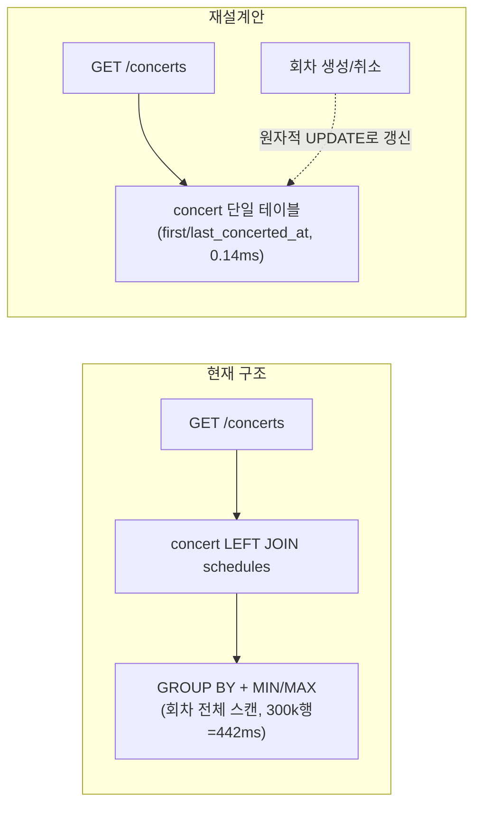

# Step 4 선택 심화 ① 조회 성능 분석 보고서

> 조회가 오래 걸릴 수 있는 기능 17개를 리스트업하고, 그중 위험도가 높은 항목을 인덱스·테이블 재설계·페이지네이션 세 축으로 실측했다. 결론: **인덱스는 대부분 이미 있었고(중복 2건 제거), 콘서트 목록 조회는 인덱스로는 개선되지 않아 테이블 재설계(비정규화)와 커서 페이지네이션을 권장안으로 도출**했다(프로덕션 코드는 변경하지 않고 권장안만 제시). 앞으로 생길 포인트 내역/예약 목록 조회는 기존 인덱스로 이미 충분함을 실측으로 확인했다.
>
> 모든 수치는 `./gradlew perfTest`로 실측한 값이며, 측정하지 않은 수치는 적지 않았다(추정은 "추정"으로 명시).
> 측정 하네스: `src/test/java/kr/hhplus/be/server/perf/` · 원본 출력: `docs/report/data/`

---

## 0. 한눈에 보기

### 요구사항 충족표

| 과제 원문 문구 | 이 보고서의 답 | 위치 |
|---|---|---|
| "조회가 오래 걸릴 수 있는 기능을 리스트업" | 현재 API 15개 + 앞으로 생길 기능 2개, 총 17개 쿼리/조작을 표로 정리 | §3 |
| "분석하여" | 항목별로 EXPLAIN 핵심 줄을 인용해 원인 분석 | §4 |
| "테이블 재설계... 솔루션을 도출" | 콘서트 목록 집계를 비정규화 컬럼 단일 테이블로, 무제한 목록을 커서 페이지네이션으로 재설계 — 회차 10,000/100,000/300,000건 규모에서 실측 | §4.2, §4.3 |
| "인덱스... 솔루션을 도출" | 기존 인덱스 실측 검증, 중복 인덱스 2건 제거, 후보 인덱스 1건 평가 후 미채택 | §4.1, §4.4~§4.8 |
| "보고서 작성" | 본 문서 | - |

### 핵심 결과 표

| 대상 | Before | After | 개선 |
|---|---:|---:|---:|
| 콘서트 목록(재설계, schedules=300,000건) | 442.0ms (join+group) | 0.139ms (비정규화 단일 테이블) | 약 3,180배 |
| 콘서트 목록 페이지네이션(100,000건, 깊은 페이지) | 14.6ms (OFFSET 99960) | 0.00666ms (커서 `id>99960`) | 약 2,190배 |
| 좌석 역조회(`seat.reservation_id`) | 104.0ms (풀스캔) | 0.00712ms (인덱스) | 약 14,600배 |
| [예정] 포인트 내역 조회(`point_history`, 30만건) | 57.6ms (인덱스 없음 가정) | 0.0143ms (기존 인덱스) | 약 4,030배 |
| 중복 인덱스 2건(`payment.idx_number`, `member.idx_uuid`) | 유지 비용만 있음 | 제거 | 읽기 영향 없음, 유지 비용 제거 |

---

## 1. 배경과 목표

Step 4 선택 심화 ①의 과제 원문은 "조회가 오래 걸릴 수 있는 기능을 리스트업하고 분석하여, **테이블 재설계 / 인덱스 등** 솔루션을 도출하는 내용의 보고서 작성"이다.

이 보고서는 다음 순서로 범위를 좁혔다.

1. 콘서트 예약 서비스의 현재 API 조회/조건부 UPDATE를 모두 리스트업한다(§3).
2. 각 쿼리를 EXPLAIN/EXPLAIN ANALYZE로 실측해 "인덱스가 실제로 쓰이는지, 없으면 얼마나 느려지는지"를 확인한다(§4.1, §4.4~§4.8).
3. 인덱스로 해결되지 않는 유일한 항목(콘서트 목록 MIN/MAX 집계)에 대해 **테이블 재설계(비정규화)**와 **페이지네이션**이라는 두 가지 솔루션을 도출하고, 프로토타입 테이블로 실측한다(§4.2, §4.3). 이것이 이번 보고서에서 처음 추가된 부분이다.
4. 현재 API에는 없지만 ERD(`docs/project/erd.md`)상 과제 도메인에 곧 필요해질 조회 두 가지(포인트 내역 조회, 회원별 예약 목록 조회)를 "예정 기능"으로 리스트업에 포함하고, 기존 인덱스가 충분한지 미리 검증한다(§4.9, §4.10).

범위 밖: 프로덕션 코드 변경(재설계안·페이지네이션은 권장안만 제시하고 실제 엔티티/리포지토리는 바꾸지 않았다 — 적용 여부는 사용자 판단), 캐시 설계(§6에서 Step 7 Redis와의 연결점만 짧게 언급).

---

## 2. 실험 설계

### 2-1. 환경

| 항목 | 값 |
|---|---|
| DB | MySQL **8.0.46** (Testcontainers `mysql:8.0`, `./gradlew test`/`perfTest`와 동일 이미지) |
| Redis | `redis:7-alpine` (이 보고서의 측정 대상은 아니지만 같은 컨테이너 세트로 기동) |
| 격리 | `IntegrationTestBase`/`TestcontainersConfiguration`과 동일한 싱글톤 컨테이너 재사용. perf 테스트는 매 테스트마다 TRUNCATE 하지 않고 **클래스당 1회만 시딩**(`PerfTestBase`, 각 클래스의 `@BeforeAll`) |
| 스키마 생성 | `spring.jpa.hibernate.ddl-auto=create-drop`(integration 프로파일 기본값), 현재 엔티티 매핑 그대로 |
| 반복·중앙값 | SELECT: `EXPLAIN ANALYZE` 5회 반복 → 중앙값 / INSERT·UPDATE: `System.nanoTime()` 3~5회 반복 → 중앙값 |
| 실행 방법 | `./gradlew perfTest`(기본 `./gradlew test`에는 `@Tag("perf")`로 제외 — `build.gradle.kts`) |
| 완료 기준 | `./gradlew perfTest` BUILD SUCCESSFUL, `./gradlew test` 전체 통과(perf 제외) |
| 재현 명령 | `./gradlew perfTest` 후 `docs/report/data/summary.csv`와 `*.txt` 확인 |

### 2-2. 데이터 규모

**기존 쿼리(§4.1, §4.4~§4.10) — 공유 데이터셋, `PerfDataSeeder`가 클래스당 1회 시딩**

| 테이블 | 건수 | 분포 비고 |
|---|---:|---|
| concert | 1,000 | - |
| schedules | 10,000 | 상위 20% 콘서트(200개)에 30회차씩, 나머지 800개에 5회차씩 — 인기 콘서트 쏠림 재현 |
| seat | 500,000 | 회차당 50석(A1~E10) |
| member | 100,000 | - |
| reservation | 200,000 | 회원당 평균 2건 |
| payment | 100,000 | 예약 중 하위 ID 100,000건만 결제 완료 |
| point | 100,000 | 회원당 1건 |
| point_history | 300,000 | 회원당 3건(CHARGE/USE 교대) |

**테이블 재설계 실험(§4.2, §4.3) — `TableRedesignPerfTest` 전용 프로토타입 테이블(`bench_*`), 공유 데이터셋과 별도**

운영 중인 `concert`/`schedules`는 다른 테스트가 공유하는 고정 규모라 건드리지 않고, 이 실험만을 위한 프로토타입 테이블을 새로 만들어 쓰고 끝나면 지운다.

| 테이블 | 건수 | 용도 |
|---|---:|---|
| `bench_concert_current` / `bench_schedule_current` | concert 1,000 고정, schedules **10,000 → 100,000 → 300,000**(순차 재시딩) | 현재 구조(join+group) 쿼리의 데이터 증가 추세 측정 |
| `bench_concert_redesign` | concert 1,000 | 재설계안(비정규화 컬럼) — 매 schedules 스케일마다 `first_concerted_at`/`last_concerted_at`을 재계산 |
| `bench_concert_paging_large` | concert 100,000 | 페이지네이션(오프셋 vs 커서) 비교용 대량 테이블 |

데이터 증가 축으로 회차(schedules) **10,000 / 100,000 / 300,000**건 세 규모를 택했다 — 기존 공유 데이터셋의 10,000건(현재 운영 규모 가정)에서 10배, 30배로 늘려 "회차가 계속 쌓이면 어떻게 되는가"를 보여준다. 콘서트(concert) 수는 1,000건으로 고정해, "콘서트당 회차 수가 느는" 현실적인 성장 패턴을 반영했다. 세 스케일 모두 수십 MB 수준이라 호스트 디스크 여유(측정 시작 시 약 6.9GB)에 영향이 없었다(측정 종료 후 약 5.9GB — perf 테스트와 별도로 동시에 실행되던 다른 테스트 프로세스의 영향도 섞여 있어 이 변화량 전부를 이번 실험에 귀속시킬 수는 없지만, 순수 추가분은 무시할 수준으로 추정된다).

### 2-3. 완료 기준

- `./gradlew perfTest` BUILD SUCCESSFUL (IndexPerfTest 8/8, TableRedesignPerfTest 3/3, UpcomingQueriesPerfTest 2/2 — 실제 실행 결과, `build/test-results/perfTest/*.xml`)
- `./gradlew test` 전체 통과(perf 제외, 실측 129/129 — 코드 리뷰 반영(대기열 승격·신규발급 혼합 실행 테스트 추가)까지 끝난 최종 수치)
- `docs/report/data/`의 모든 원본 파일명이 ASCII 케밥 케이스

### 2-4. 재현 범위 — 원본 데이터와 본문 수치의 차이

`docs/report/data/`의 원본 파일(`summary.csv`, `*.txt`)은 **마지막으로 실행한 `./gradlew perfTest`
결과**이고, 본문(§3~§4)에 인용한 수치는 그 이전 실행 결과를 그대로 적어둔 것이다 — `perfTest`는
EXPLAIN ANALYZE/INSERT 벤치마크를 실제 MySQL(Testcontainers)에 대고 돌리는 측정이라, 재실행할
때마다 호스트 부하·캐시 상태에 따라 **수 % 범위**에서 값이 달라질 수 있다. 예를 들어 §4.2의 콘서트
목록 집계(schedules=10,000/100,000/300,000)는 본문에 현재 구조 6.55ms/52.0ms/442.0ms, 재설계안
0.155ms/0.137ms/0.139ms로 적어뒀지만, `docs/report/data/summary.csv`의 가장 최근 실행값은 현재
구조 **6.92ms/53.3ms/445.0ms**, 재설계안 **0.185ms/0.137ms/0.133ms**로 수 % 수준에서 차이가 난다.
`perfTest`를 다시 실행하면 이 정도 폭의 변동은 정상이며, 결론 자체(인덱스로는 해결되지 않음 /
재설계안이 현재 구조보다 수백~수천 배 빠름 / 데이터가 늘수록 현재 구조는 초선형으로 나빠지고
재설계안은 평탄함)는 재실행마다 일관되게 재현된다. 최신 수치로 다시 확인하려면 `./gradlew perfTest`
실행 후 `docs/report/data/summary.csv`를 읽는다.

---

## 3. 리스트업

| # | 쿼리/조작 | 호출 경로 | 빈도 추정 | 데이터 증가 축 | 위험도 | 이유 |
|---|---|---|---|---|---:|---|
| 1 | `SpringSeatJpa.findAllByScheduleId`(회차별 좌석 목록, `ORDER BY id`) | `GET /api/v1/reservation/seats/{scheduleId}` ← `SeatFacade.getSeatsInfo` | **상** — 대기열 통과 직후, 트래픽 집중 | `seat` 행 수 | 중 | 회차당 행 수는 적어 풀스캔이어도 느리지 않지만 호출 빈도가 가장 높아 회귀에 취약(§4.6) |
| 2 | `SpringSeatJpa.findByScheduleIdAndSeatIds` | `POST /api/v1/reservation/seats` ← `ReserveSeatService`, 분산락 내부 | 상 — 예약 시도마다 | `seat` 전체 행 수 | 중 | PK `IN` 조건이 선택적이라 PRIMARY 사용(§4.8) |
| 3 | `SpringSeatJpa.findAllByReservationId` | `GET /api/v1/payments/{reservationId}` **+** `POST /api/v1/payments` — **한 예약당 최소 2회** | **상** | `seat` 전체 행 수(500,000) | **상** | 인덱스 없이는 풀스캔(§4.4 — 104.0ms) |
| 4 | `SpringSeatJpa.holdAvailableSeats`(조건부 UPDATE) | `POST /api/v1/reservation/seats`, 분산락 내부 | 상 | `seat` 전체 행 수 | 중 | PK 범위 스캔(§4.7) — 쿼리 의미 변경 금지 |
| 5 | `SpringSeatJpa.releaseHeldSeats`(조건부 UPDATE) | `SeatHoldScheduler`(1초 주기) | **상** | `seat` 전체 행 수 | 중 | PK 범위 스캔(§4.7) — 주기적 배치라 느려지면 누적 |
| 6 | `SpringSeatJpa.confirmHeldSeats`(조건부 UPDATE) | `POST /api/v1/payments`, 분산락 내부 | 상 | `seat` 전체 행 수 | 중 | PK 범위 스캔(§4.7) — 정합성 방어선, 의미 변경 금지 |
| 7 | `ConcertRepositoryImpl.findConcerts`(콘서트 목록 MIN/MAX 집계, **LIMIT 없음**) | `GET /api/v1/concerts` | **상** — 서비스 진입점(첫 화면) | `concert`×`schedules`, 응답 크기도 `concert` 전체와 비례 | **상** | 인덱스로는 개선 안 됨(§4.1) + 회차가 늘수록 **더 나쁘게**(초선형으로) 느려짐(§4.2) + LIMIT이 없어 콘서트가 늘수록 응답도 선형 증가(§4.3) |
| 8 | `ConcertRepositoryImpl.findConcertDetailById` | `GET /api/v1/concerts/{concertId}` | 중 | `schedules` | 하 | 이미 최적(§4.8) |
| 9 | `ScheduleRepositoryImpl.findAvailableConcerts` | `GET /api/v1/concerts/{concertId}/schedules` | 중 | `schedules` | 하 | 같은 인덱스로 선택적 조회, 효과 큼(§4.1) |
| 10 | `ReservationQueryRepositoryCustomImpl.getWithDetailsById`(seat⋈schedules⋈concert) | #3과 동일 경로, 한 예약당 2회 이상 | **상** | `seat` 전체 행 수 | **상** | #3과 같은 인덱스 의존(§4.4 — 84.2ms) |
| 11 | `SpringPaymentJpa.findByReservationId`(중복 결제 검증) | `POST /api/v1/payments` ← `ProcessPaymentService.validatePaymentRequest` | 상 | `payment` 전체 행 수(100,000) | **상** | 인덱스 없이는 풀스캔(§4.4 — 38.0ms). Step4 선택 심화②(동시성) 이후 **UNIQUE 제약**(`uk_payment_reservation_id`)으로 승격되어 있음 |
| 12 | `SpringPointJpa.findByMemberId` | 충전/조회/차감 | 상 | `point` | 하 | 이미 최적(§4.8) |
| 13 | `SpringPointHistoryJpa` 커스텀 조회 | 없음 — `save()`만 호출됨 | - | - | - | 현재 이 인덱스(`idx_member_id_created_at`)를 쓰는 조회가 없다 — 포인트 내역 조회 API가 아직 없어 미사용. 곧 생길 기능은 #16 |
| 14 | `MemberRepository.findByLoginId` | `POST /api/v1/auth/signin` | 중 | `member` | 하 | 이미 최적(§4.8) |
| 15 | `MemberRepository.findByUuid` | **인증된 모든 요청** | **최상** | `member` | 하 | UNIQUE 인덱스 const 조회 — 빈도는 최상이지만 이미 최적(§4.5) |
| 16 | **[예정]** `point_history` by member, 최신순 페이지 | 포인트 내역 조회 API(아직 없음, ERD상 예정) | 중(기능 출시 시 상) | `point_history` 전체 행 수(300,000) | 중 | 기존 인덱스(`idx_member_id_created_at`)가 이미 있어 선제 검증 필요(§4.9) |
| 17 | **[예정]** `reservation` by member, 최신순 페이지 | 회원별 예약 목록 조회 API(아직 없음, ERD상 예정) | 중(기능 출시 시 상) | `reservation` 전체 행 수(200,000) | 중 | 기존 인덱스(`idx_member_id`)가 정렬 컬럼을 포함하지 않아 충분한지 선제 검증 필요(§4.10) |

**위험도 "상" 요약**: #3·#10·#11은 "결제 대기 조회 + 결제 처리"라는 좁은 경로에 몰려 있고 모두 이미 전용 인덱스(또는 UNIQUE 제약)로 해결돼 있다. **#7(콘서트 목록)만 유일하게 인덱스로 해결되지 않는 항목**이라 이번 보고서에서 테이블 재설계·페이지네이션으로 별도 분석했다(§4.2, §4.3).

---

## 4. 항목별 분석

### 4.1 콘서트 목록 집계 — 인덱스 무효 확인

- **문제**: `ConcertRepositoryImpl.findConcerts()`(콘서트 목록, `GET /api/v1/concerts`)가 `concert LEFT JOIN schedules`로 MIN/MAX를 집계한다. `schedules.idx_concert_id_concerted_at`이 있는데도 느리지 않은가?
- **원인(EXPLAIN)**: `GROUP BY`에 선택적 WHERE가 없어 옵티마이저가 `concert` 전체를 `Using temporary`로 모은다. 인덱스가 있어도 전략만 "네스티드 루프 + 커버링 인덱스"로 바뀔 뿐, 모아야 하는 그룹 수(1,000)는 그대로다.
- **결과(전후 비교, schedules=10,000건 공유 데이터셋)**:

  | 쿼리 | 상태 | table | type | key | rows | Extra | 시간(ms) |
  |---|---|---|---|---|---:|---|---:|
  | 콘서트 목록 집계 | before(인덱스 없음, FK 임시 제거) | c | ALL | – | 1000 | Using temporary | 5.90 |
  | 〃 | after(인덱스 있음=현재 코드) | c | ALL | – | 1000 | Using temporary | 6.25 |
  | 회차 단건 조회(`concert_id=500`) | before(인덱스 없음) | schedules | ALL | – | 9976 | Using where | 1.52 |
  | 〃 | after(인덱스 있음=현재 코드) | schedules | ref | idx_concert_id_concerted_at | 5 | – | 0.00533 |

  인덱스가 FK(`concert_id`)에 걸려 있어 DROP INDEX 자체가 거부된다(`Cannot drop index idx_concert_id_concerted_at: needed in a foreign key constraint`, 실측 확인) — FK를 먼저 떼어내야 "없음" 상태를 만들 수 있었다.
- **해석**: 집계 쿼리는 **인덱스 있고 없고 차이가 없다**(5.90ms vs 6.25ms, 오히려 인덱스 있는 쪽이 근소하게 느림 — 노이즈 수준). 반면 같은 인덱스로 콘서트 1건의 회차만 조회하면 **약 285배**(1.52ms → 0.00533ms) 빨라진다. **같은 인덱스가 쿼리 모양에 따라 전혀 다른 효과를 낸다.**
- **트레이드오프**: 없음(인덱스는 FK 지지용으로도 필수라 유지 — §5 ADR-1).

### 4.2 콘서트 목록 집계 — 테이블 재설계(비정규화)

- **문제**: §4.1에서 인덱스로 해결되지 않는다는 게 확인됐다. 회차(schedules)가 계속 쌓이면 이 쿼리는 얼마나 나빠지는가? 구조를 바꾸면 해결되는가?
- **솔루션(안 A)**: `concert`에 `first_concerted_at`/`last_concerted_at` 비정규화 컬럼을 추가하고, 목록 조회를 `concert` 단일 테이블 조회로 바꾼다. 회차 생성/변경 시 두 컬럼을 함께 갱신한다.
- **원인(EXPLAIN, 현재 구조)**: schedules=300,000건에서 `EXPLAIN ANALYZE` 최상위 노드가 `Aggregate using temporary table`(실측 1회차 actual time=534ms)이고, 그 아래 `Nested loop left join`은 81.6ms에 불과하다 — **즉 비용 대부분이 그룹 집계용 임시 테이블 자체**에서 발생한다. 임시 테이블이 처리해야 하는 행 수(조인 결과, 1,000/100,000/300,000건)가 늘수록 MySQL의 메모리 임시 테이블(`tmp_table_size`/`max_heap_table_size`, 기본값 수준)을 넘어 디스크 기반 임시 테이블로 전환될 가능성이 있다(**추정** — 직접 `information_schema`로 스필 여부를 확인하지는 않았다).
- **결과 — 회차 건수별 추세 실측**:

  | schedules 건수 | 현재 구조(join+group) | 재설계안(비정규화 단일 테이블) | 배수 |
  |---:|---:|---:|---:|
  | 10,000 | 6.55ms | 0.155ms | 약 42배 |
  | 100,000 | 52.0ms | 0.137ms | 약 380배 |
  | 300,000 | 442.0ms | 0.139ms | 약 3,180배 |

  현재 구조는 schedules가 10배(10,000→100,000) 늘 때 시간이 약 7.9배, 30배(10,000→300,000) 늘 때 약 67.5배로 **늘어난 데이터보다 더 나쁘게(초선형으로)** 느려졌다. 재설계안은 schedules 규모와 무관하게 **0.14~0.16ms로 평탄**했다 — concert(1,000건) 한 테이블만 읽기 때문이다.
- **쓰기 경로 비용(회차 생성 시 비정규화 컬럼 동시 갱신)**: 회차 2,000건을 단건 INSERT로 순차 생성(API 호출 1건=1행을 흉내)했을 때,

  | 시나리오 | median(2,000건) | 건당 |
  |---|---:|---:|
  | 회차 INSERT만(현재 구조와 동일) | 2,430.9ms | 1.2154ms |
  | 회차 INSERT + concert 비정규화 컬럼 UPDATE(재설계안) | 2,992.3ms | 1.4962ms |

  건당 약 **0.28ms(약 23%) 추가** — 회차 생성은 읽기보다 훨씬 드문 이벤트이므로(목록 조회는 첫 화면마다, 회차 생성은 콘서트 등록 시에만) 이 정도 쓰기 비용 증가는 합리적인 트레이드오프로 판단된다.
- **정합성 유지 방법**: `UPDATE concert SET first_concerted_at = LEAST(COALESCE(first_concerted_at, ?), ?), last_concerted_at = GREATEST(...) WHERE id = ?`처럼 **단일 원자적 UPDATE 문**으로 갱신해야 동시에 여러 회차가 생성돼도 레이스 컨디션 없이 최소/최대값이 수렴한다. 회차 취소/삭제 시에는 "남은 회차 중 최소/최대"를 다시 계산해야 하므로(단순 LEAST/GREATEST로는 줄어드는 방향을 처리할 수 없음) 삭제 경로에서는 `SELECT MIN/MAX ... WHERE concert_id=?`로 재계산하는 보정 쿼리가 필요하다.
- **트레이드오프**:
  - 장점: 목록 조회가 데이터 증가와 무관하게 평탄, 회차 수가 아무리 늘어도 영향 없음
  - 단점: 비정규화 컬럼이라 **정합성이 코드 레벨로 이전**된다(DB가 자동으로 보장해주지 않음) — 회차 생성/취소 경로 둘 다 빠짐없이 갱신해야 하고, 배치로 재검증하는 안전장치가 필요
  - 단점: 쓰기 경로에 약 23% 비용 추가(회차 생성 빈도가 낮아 수용 가능하다고 판단)



### 4.3 콘서트 목록 — 페이지네이션(오프셋 vs 커서)

- **문제**: `findConcerts()`에는 `LIMIT`이 없다. 콘서트가 계속 늘면 응답 크기·시간이 어떻게 되는가? 페이지네이션을 추가한다면 오프셋과 커서 중 무엇이 나은가?
- **솔루션(안 B)**: `WHERE id > :cursor ORDER BY id LIMIT :size` 형태의 커서 페이지네이션.
- **결과 — 응답 크기 증가(LIMIT 없는 전체 조회)**:

  | 데이터 규모 | 시간(median) |
  |---:|---:|
  | 1,000행 | 0.145ms |
  | 100,000행 | 37.2ms |

  콘서트가 100배 늘면 LIMIT 없는 조회 시간도 약 257배 늘어난다 — 응답 크기(그리고 그걸 JSON으로 직렬화하는 비용까지 포함하면) 실제 API 응답 시간은 이보다 더 벌어질 것으로 추정된다.
- **결과 — 오프셋 vs 커서(100,000행, 얕은 페이지 vs 깊은 페이지)**:

  | 방식 | 얕은 페이지 | 깊은 페이지(끝에서 20번째) | 깊은 페이지 배수 |
  |---|---:|---:|---:|
  | 오프셋(`OFFSET 20` / `OFFSET 99960`) | 0.00991ms | 14.6ms | 약 1,470배 느려짐 |
  | 커서(`id > 20` / `id > 99960`) | 0.0182ms | 0.00666ms | 거의 동일(오히려 더 빠름) |

- **원인(EXPLAIN)**: 오프셋 깊은 페이지는 `Index scan ... (actual time=0.0175..12.7 rows=99980 loops=1)` — LIMIT/OFFSET 이전까지의 **99,980행을 모두 읽고 버린 뒤** 마지막 20행만 반환한다. 커서 깊은 페이지는 `Index range scan ... over (99960 < id) (actual time=0.00271..0.00575 rows=20 loops=1)` — **처음부터 정확히 20행만** 읽는다. 오프셋 깊은 페이지(14.6ms) vs 커서 깊은 페이지(0.00666ms) = **약 2,190배** 차이.
- **트레이드오프**:
  - 장점: 커서 방식은 페이지 깊이와 무관하게 `O(LIMIT)` — 데이터가 아무리 늘어도 뒷페이지가 느려지지 않음
  - 단점: "3페이지로 바로 이동" 같은 임의 접근(랜덤 액세스)이 불가능하고, 정렬 기준 컬럼에 중복 값이 있으면 커서 안정성을 위해 보조 정렬 키(예: `id`)가 필요
  - 단점: API 계약 변경(쿼리 파라미터를 `page`에서 `cursor`로) — 프런트엔드와 `docs/project/api-specs.yaml` 동시 수정 필요

### 4.4 좌석/결제 역방향 조회 — `seat.idx_reservation_id`, `payment.uk_payment_reservation_id`

- **문제**: 예약 ID로 좌석·결제를 거꾸로 찾는 조회(결제 대기 화면, 결제 처리)에 인덱스가 실제로 쓰이는가?
- **원인(EXPLAIN, before)**: `seat WHERE reservation_id=777` → `type=ALL, rows≈496593, Extra=Using where`(풀스캔). `payment WHERE reservation_id=777` → `type=ALL, rows=98325`(풀스캔).
- **결과**:

  | 쿼리 | before(인덱스 없음) | after(현재 코드) | 배수 |
  |---|---:|---:|---:|
  | `seat WHERE reservation_id=?` | 104.0ms | 0.00712ms(`type=ref`, key=`idx_reservation_id`) | 약 14,600배 |
  | 예약 상세 조회(seat⋈schedules⋈concert) | 84.2ms | 0.0157ms | 약 5,360배 |
  | `payment WHERE reservation_id=?` | 38.0ms | 0.000084ms(`type=const`, key=`uk_payment_reservation_id`) | 참고용(아래 설명) |

- **중요한 변화**: Step4 선택 심화 ②(동시성, `docs/report/step4-concurrency-report.md`)에서 `payment.reservation_id`에 "예약당 결제 1건"을 강제하는 **UNIQUE 제약**(`uk_payment_reservation_id`)이 추가됐다(`PaymentEntity.kt`). 이 보고서를 작성하는 시점에 하네스를 그 이름(`idx_reservation_id` → `uk_payment_reservation_id`)으로 갱신했다. 그 결과 EXPLAIN의 `type`이 기존 보고서 기준 `ref`에서 **`const`로 더 좋아졌다** — UNIQUE 제약은 "최대 1건"을 보장하므로 옵티마이저가 실행 전 계획 단계에서 행을 확정할 수 있다. `const` 조회의 시간 값(0.000084ms)은 실행이 아니라 계획 단계 값이라 비교 근거로는 쓰지 않고, "구조적으로 인덱스가 반드시 쓰인다"는 사실만 근거로 삼았다(§7 참고).
- **트레이드오프**: 없음(두 인덱스 모두 유지 — §5 ADR-2, ADR-3).

### 4.5 중복 인덱스 제거 — `payment.idx_number`, `member.idx_uuid`

- **문제**: `number`/`uuid` 컬럼에 `UNIQUE` 제약과 별도 인덱스가 겹쳐 있었다. 옵티마이저가 둘 중 뭘 쓰는가?
- **원인(EXPLAIN)**: 제거 전/후 `key` 컬럼이 **완전히 동일**(항상 `UNIQUE` 제약 인덱스) — 옵티마이저가 중복 인덱스를 선택 대상에 넣지 않았다.
- **결과**:

  | 쿼리 | 제거 후(현재 코드, UNIQUE만) | 제거 전(UNIQUE+중복 인덱스, 가정) |
  |---|---:|---:|
  | `payment WHERE number=?` | 0.000042ms | 0.000042~0.000124ms |
  | `member WHERE uuid=?` | 0.000042ms | 0.000125ms |

  값 자체는 `const` 조회라 계획 단계 수치(수십 나노초)라 비교 근거로 쓰지 않았다 — "`key`가 제거 전후 동일하다"는 **구조적** 증거만 근거로 삼았다.
- **쓰기 비용(2만 건 batch INSERT, 3회 반복)**:

  | 상태 | median |
  |---|---:|
  | 제거 후(idx_number 없음) | 562.1ms |
  | 제거 전(idx_number 있음, 가정) | 638.6ms |

  방향(제거 쪽이 빠름)은 가설과 일치하지만 개별 샘플이 494.7~902.3ms로 넓게 흩어져 있어 **노이즈보다 크다고 결론 내릴 수 없다**(§7).
- **트레이드오프**: 읽기 이득 없이 유지 비용(쓰기 시 B-Tree 하나 더 관리)만 있다고 판단해 제거(§5 ADR-4, ADR-5). 이미 적용됨(`PaymentEntity.kt`, `Member.kt`).

### 4.6 회차별 좌석 조회 `ORDER BY id` — filesort + 후보 인덱스

- **문제**: `seat WHERE schedule_id=? ORDER BY id`가 `uk_schedule_id_number`로는 정렬이 안 돼 filesort가 발생한다. `(schedule_id, id)` 후보 인덱스를 추가하면 나아지는가?
- **결과**:

  | 상태 | key | Extra | 시간 |
  |---|---|---|---:|
  | 후보 인덱스 추가 전(현재 코드) | uk_schedule_id_number | Using filesort | 0.0593ms |
  | 후보 인덱스 추가 후 | uk_schedule_id_number | Using filesort | 0.0322ms |

  `key`와 `Extra`가 추가 전후 **동일** — 옵티마이저가 새 인덱스를 선택하지 않았다(회차당 50행뿐이라 filesort 비용이 이미 무시할 수준). 시간차(0.06ms→0.03ms)는 반복 간 노이즈.
- **트레이드오프**: 후보 인덱스는 쓰기 비용만 추가하고 읽기 이득이 없어 **도입하지 않음**(§5 ADR-6).

### 4.7 조건부 UPDATE 3종 — PK 사용 확인

- **문제**: 좌석 홀드/해제/확정 UPDATE가 동시성 방어선 역할을 한다. 인덱스가 필요한가?
- **결과**: 셋 다 `id IN (...)`이 `type=range, key=PRIMARY`로 처리되고, `status`/`reservation_id` 조건은 가져온 소수 행(3건)에만 추가로 적용된다.

  | UPDATE | key | 시간(median, wall-clock 5회) |
  |---|---|---:|
  | `holdAvailableSeats` | PRIMARY | 1.440ms |
  | `releaseHeldSeats` | PRIMARY | 1.133ms |
  | `confirmHeldSeats` | PRIMARY | 1.158ms |

  MySQL 8.0.46에서 `EXPLAIN ANALYZE UPDATE`는 `<not executable by iterator executor>`로 거부되어(실측 확인) 계획(EXPLAIN)과 실행 시간(wall-clock)을 따로 측정했다.
- **트레이드오프**: 이미 최적, 변경 없음. 과제 제약("정합성 관련 조건부 UPDATE의 의미는 바꾸지 말 것")에도 부합.

### 4.8 기타 — 이미 최적으로 확인된 조회

| 쿼리 | table | type | key | rows | filtered |
|---|---|---|---|---:|---:|
| `findByScheduleIdAndSeatIds` | seat | range | PRIMARY | 3 | 1.67 |
| `findConcertDetailById` | c | const | PRIMARY | 1 | 100.0 |
| `findByLoginId` | member | const | UKenfm5patwjqulw8k4wwuo6f60 | 1 | 100.0 |
| `point.findByMemberId` | point | const | UKe89kvxel18suao0yk1h4bsc3 | 1 | 100.0 |

`findByScheduleIdAndSeatIds`가 `schedule_id` 인덱스가 아니라 **PK(`id IN`)를 선택**한 게 눈에 띈다 — `IN` 목록이 매우 선택적(3건)이라 더 싼 경로를 고른 것. `point.findByMemberId`는 이전 보고서 작성 이후 `point.member_id`에 `UNIQUE` 제약이 추가돼(`UKe89kvxel18suao0yk1h4bsc3`) `type`이 `ref`에서 `const`로 바뀌었다.

### 4.9 [예정] 포인트 내역 조회 — 기존 인덱스로 충분

- **문제**: 포인트 내역 조회 API는 아직 없지만(#13), ERD(`docs/project/erd.md`)상 "최신 내역 조회 최적화"용으로 `idx_member_id_created_at`이 이미 있다. 쿼리를 미리 시뮬레이션하면 이 인덱스로 충분한가?
- **시뮬레이션 쿼리**: `SELECT * FROM point_history WHERE member_id = ? ORDER BY created_at DESC LIMIT 20`(30만 건 데이터셋).
- **원인(EXPLAIN)**: 인덱스 없이는 `type=ALL, Extra=Using where; Using filesort`(30만 행 풀스캔 후 정렬). 인덱스가 있으면 `type=ref, key=idx_member_id_created_at, Extra=Backward index scan` — MySQL 8.0의 "역방향 인덱스 스캔" 최적화로 `DESC` 정렬에도 filesort 없이 인덱스 순서를 그대로 거슬러 읽는다.
- **결과**:

  | 상태 | 시간 |
  |---|---:|
  | 인덱스 없음(가정) | 57.6ms |
  | 기존 인덱스(현재 스키마) | 0.0143ms |

  약 **4,030배** 차이. **결론: 기존 인덱스(`idx_member_id_created_at`)로 충분하며, 추가 인덱스는 필요 없다.**

### 4.10 [예정] 회원별 예약 목록 조회 — 기존 인덱스로 충분

- **문제**: 회원별 예약 목록 API도 아직 없지만(ERD상 "내 예약 목록 조회" 용도로 `reservation.idx_member_id`가 이미 있다). 이 인덱스는 `member_id`만 포함하고 정렬 컬럼(`id`/`created_at`)은 포함하지 않는데, 충분한가?
- **시뮬레이션 쿼리**: `SELECT * FROM reservation WHERE member_id = ? ORDER BY id DESC LIMIT 20`(20만 건 데이터셋, 회원당 평균 2건).
- **원인(EXPLAIN)**: 인덱스 없이는 `type=index, key=PRIMARY, Extra=Using where; Backward index scan`(PK 역순 전체 스캔 중 필터링). 인덱스가 있으면 `type=ref, key=idx_member_id, Extra=Backward index scan`.
- **결과**:

  | 상태 | 시간 |
  |---|---:|
  | 인덱스 없음(가정) | 34.7ms |
  | 기존 인덱스(현재 스키마) | 0.00987ms |

  약 **3,520배** 차이. 회원당 평균 2건뿐이라 정렬 컬럼을 포함한 복합 인덱스(`member_id, id`)가 없어도 체감 비용이 거의 없다. **결론: 기존 단일 컬럼 인덱스로 충분하다.** 다만 이건 "회원 1명이 예약을 아주 많이 하지 않는다"는 가정에 의존하므로, 소수의 회원이 수백~수천 건을 예약하는 이상 패턴이 생기면 재검토가 필요하다(§7).

---

## 5. 의사결정 기록(ADR)

| ID | 상태 | 맥락 | 결정 | 결과(장점 / 단점) |
|---|---|---|---|---|
| ADR-1 | 적용됨 | `schedules.idx_concert_id_concerted_at`가 집계 쿼리엔 거의 무용(§4.1) | **유지**(변경 없음) | 장점: FK 지지에 구조적으로 필수, 회차 단건 조회엔 285배 효과 / 단점: 없음 |
| ADR-2 | 적용됨 | `seat.idx_reservation_id`가 "상" 위험도 쿼리 2개에 핵심(§4.4) | **유지** | 장점: 최대 14,600배 단축 / 단점: 없음 |
| ADR-3 | 적용됨(Step4②) | `payment.reservation_id`에 UNIQUE 제약 필요(§4.4) | **유지**(`uk_payment_reservation_id`) — 이 보고서 작성 이전에 동시성 보고서에서 결정됨, 여기서는 하네스 이름만 갱신 | 장점: 읽기도 `const`로 더 좋아짐 / 단점: 동시성 보고서 참고 |
| ADR-4 | 적용됨 | `payment.idx_number`가 `UNIQUE` 제약과 중복(§4.5) | **제거**(`PaymentEntity.kt`) | 장점: 읽기 영향 없이 유지 비용 제거 / 단점: 운영 DB는 `ddl-auto=update`로 자동 반영되지 않음(§6) |
| ADR-5 | 적용됨 | `member.idx_uuid`가 `UNIQUE` 제약과 중복(§4.5) | **제거**(`Member.kt`) | 장점: 인증 경로(빈도 최상)에 영향 없이 유지 비용 제거 / 단점: 위와 동일 |
| ADR-6 | 적용됨(미도입) | `seat(schedule_id, id)` 후보 인덱스가 filesort를 없애지 못함(§4.6) | **도입하지 않음** | 장점: 불필요한 쓰기 비용을 추가하지 않음 / 단점: 없음(옵티마이저가 쓰지 않는 인덱스였음) |
| ADR-7 | **제안됨(미적용)** | 콘서트 목록 집계가 회차 증가에 초선형으로 느려짐(§4.2) | concert에 `first_concerted_at`/`last_concerted_at` 비정규화 컬럼 추가, 단일 테이블 조회로 전환 | 장점: 회차 규모와 무관하게 평탄(0.14ms대) / 단점: 정합성이 애플리케이션 코드로 이전, 쓰기 비용 +23% |
| ADR-8 | **제안됨(미적용)** | `findConcerts()`에 LIMIT이 없어 콘서트 증가 시 응답이 선형 증가(§4.3) | 커서 기반 페이지네이션(`WHERE id > :cursor ORDER BY id LIMIT :size`)으로 전환 | 장점: 페이지 깊이와 무관하게 O(LIMIT), 깊은 페이지에서 오프셋 대비 2,190배 / 단점: 임의 페이지 이동 불가, API 계약 변경 필요 |
| ADR-9 | **제안됨(현재는 변경 불필요)** | 예정 기능(포인트 내역/예약 목록 조회)의 인덱스 충분성(§4.9, §4.10) | 기존 인덱스(`idx_member_id_created_at`, `idx_member_id`) 그대로 사용, 신규 인덱스 추가하지 않음 | 장점: 추가 비용 없이 4,030배/3,520배 효과 확인 / 단점: 회원당 레코드 수가 비정상적으로 커지면(예: 특정 회원이 수천 건) 재검토 필요 |

---

## 6. 적용 현황과 후속 과제

### 적용함
- `payment.idx_number`, `member.idx_uuid` 제거(ADR-4, ADR-5) — 이미 코드에 반영됨.

### 권장하지만 미적용(이유)
- **콘서트 목록 테이블 재설계(ADR-7)**, **커서 페이지네이션(ADR-8)** — 프로토타입 테이블로 효과를 실측했지만, 프로덕션 엔티티/리포지토리/API 계약 변경은 이번 보고서의 범위가 아니라 적용하지 않았다(사용자 판단 대상). 적용 시 변경 범위와 절차는 아래 참고.

#### 재설계(안 A) 적용 시 변경 범위·마이그레이션 절차
1. `ALTER TABLE concert ADD COLUMN first_concerted_at DATETIME NULL, ADD COLUMN last_concerted_at DATETIME NULL;` — MySQL 8.0.12+에서 nullable 컬럼 추가는 보통 `INSTANT` 알고리즘으로 처리돼 운영 중 테이블 잠금 없이 가능할 것으로 **추정**(이번 측정에서 직접 확인하지는 않았다).
2. 백필: `UPDATE concert c JOIN (SELECT concert_id, MIN(concerted_at) mn, MAX(concerted_at) mx FROM schedules GROUP BY concert_id) s ON c.id=s.concert_id SET c.first_concerted_at=s.mn, c.last_concerted_at=s.mx;` — 콘서트 수가 많아지면 PK 범위로 나눠 배치 실행 권장.
3. `Schedule` 생성/변경/삭제 유스케이스에 `concert`의 두 컬럼을 같이 갱신하는 로직 추가. 생성/변경은 원자적 `LEAST`/`GREATEST` UPDATE로, 삭제는 "남은 회차 중 MIN/MAX 재계산" 쿼리로 처리(§4.2).
4. `ConcertRepositoryImpl.findConcerts()`를 join 없는 단일 테이블 조회로 변경.
5. 배치 잡으로 주기적 정합성 재검증(실제 schedules MIN/MAX와 비정규화 컬럼 비교) 권장.
6. 롤백: 컬럼은 남겨두고 조회만 기존 join 버전으로 즉시 되돌릴 수 있게 유지.

#### 페이지네이션(안 B) 적용 시 변경 범위
1. API에 `cursor`(마지막 `concert.id`) + `size` 파라미터 추가, `docs/project/api-specs.yaml` 갱신.
2. `ConcertRepositoryImpl.findConcerts()`에 `WHERE id > :cursor ORDER BY id LIMIT :size` 추가 — 안 A(재설계)와 함께 적용하면 join 없이 바로 가능해 구현이 더 단순하다.
3. 프런트엔드(`concert-front`) 목록 화면을 "다음 페이지 불러오기" 방식으로 변경.
4. 스키마 변경이 없어 안 A보다 위험도가 낮고 독립적으로 적용 가능.

#### (선택) 안 C: 캐시
콘서트 목록은 회차 생성/변경 시에만 바뀌는 데이터라 Step 7(Redis) 도입 이후 TTL 또는 명시적 무효화 캐시를 얹으면 추가로 DB 부하를 줄일 수 있다. 이번 보고서 범위에서는 실측하지 않고 연결점만 남긴다.

### 운영 반영 절차 — `ddl-auto=update`가 인덱스를 지우지 않는다(실측, 변경 없음)

이전 조사(현재 엔티티로 `create-drop` 스키마를 만든 뒤 raw JDBC로 `idx_number`/`idx_uuid`를 수동 추가해 "마이그레이션 전" 상태를 흉내내고, 같은 DB에 `ddl-auto=update`로 새 Spring 컨텍스트를 띄워 확인)에서 **`idx_number`/`idx_uuid` 둘 다 그대로 남아 있었다** — Hibernate의 `update` 모드는 "추가만 하고 제거는 하지 않는다." 운영에 반영하려면 수동 마이그레이션(`ALTER TABLE ... DROP INDEX ...`)이 필요하다. (1회성 조사라 재현 테스트 코드는 남기지 않음, 이번 보고서 갱신 시에도 다시 실행하지 않았다.)

---

## 7. 한계

- **단일 Testcontainers 인스턴스, 콜드 캐시가 아닌 실행 중 캐시 상태**: InnoDB 버퍼 풀에 이미 올라간 데이터로 반복 측정했다. 절대 시간(특히 μs~0.0x ms 구간)은 운영에 그대로 적용되지 않지만, 상대적인 배수(수백~수만 배)는 구조적 차이(풀스캔 vs 인덱스 탐색, 메모리 vs 디스크 임시 테이블)라 방향성은 유지될 것으로 본다.
- **`rows`는 추정치**: 재설계 실험에서 `bench_concert_redesign`을 막 TRUNCATE+재적재한 직후 EXPLAIN의 `rows` 추정이 "1"로 나온 경우가 있었다(실제 스캔된 행수는 `EXPLAIN ANALYZE`의 `actual ... rows=1000`으로 항상 정확히 1,000이었다) — 통계가 갱신되기 전의 추정 오차.
- **테이블 재설계의 "임시 테이블이 디스크로 스필된다"는 설명은 추정이다**: `EXPLAIN ANALYZE`의 actual time 분포(조인 자체보다 집계용 임시 테이블 단계의 비중이 압도적으로 큼)로 미뤄 추론한 것이고, `information_schema`나 서버 상태 변수로 메모리/디스크 전환 여부를 직접 확인하지는 않았다.
- **쓰기 비용(2만 건 INSERT, 재설계 쓰기 경로 2,000건) 측정은 반복 수가 적고(3회) 노이즈가 크다**: 중복 인덱스 쓰기 비용은 방향만 일치하고 노이즈 범위를 벗어나지 못했다. 재설계 쓰기 경로(+23%)는 매 반복 간 편차가 있어 정확한 비율이라기보다 "의미 있는 수준으로 증가한다"는 방향성으로 해석해야 한다.
- **`EXPLAIN ANALYZE`는 UPDATE/DELETE를 지원하지 않는다**(MySQL 8.0.46, 실측 확인). 조건부 UPDATE 3종은 계획(EXPLAIN)과 실행 시간(wall-clock)을 따로 측정했다.
- **const/UNIQUE 조회의 시간 값은 비교 대상이 아니다**: 계획 단계에서 행이 확정되는 조회는 수십 나노초로 찍혀 실제 요청 비용(네트워크·커넥션)과 무관하다 — "구조적으로 인덱스가 쓰인다"는 사실만 근거로 삼았다.
- **예정 기능(§4.9, §4.10)은 단일 회원·단일 데이터 분포로만 시뮬레이션했다**: 포인트 내역은 회원당 3건, 예약은 회원당 평균 2건인 균등 분포를 가정했다. 실제 서비스에서 "헤비 유저"가 압도적으로 많은 레코드를 쌓는 롱테일 분포라면 결론(기존 인덱스로 충분)이 달라질 수 있다.
- **테이블 재설계·페이지네이션 실험은 프로덕션 엔티티가 아니라 프로토타입 테이블(`bench_*`)로 수행했다**: 운영 환경의 제약(Hibernate 매핑, 트랜잭션 경계, 분산락과의 상호작용)까지 재현하지는 않았다 — 실제 적용 시 §6의 마이그레이션 절차에서 추가 검증이 필요하다.

---

## 부록 A. 원본 데이터 목록

`docs/report/data/`의 모든 원본 파일(ASCII 케밥 케이스, 2026-10-22 `perfTest` 재실행 기준).

| 파일 | 내용 |
|---|---|
| `01-concert-list-agg-before.txt` / `-after.txt` | §4.1 콘서트 목록 집계, 인덱스 전/후 |
| `01b-schedule-by-concert-id-before.txt` / `-after.txt` | §4.1 회차 단건 조회, 인덱스 전/후 |
| `02-seat-by-reservation-id-before.txt` / `-after.txt` | §4.4 좌석 역조회, 인덱스 전/후 |
| `03-reservation-detail-before.txt` / `-after.txt` | §4.4 예약 상세 조회(3-way join), 인덱스 전/후 |
| `04-payment-by-reservation-id-before.txt` / `-after.txt` | §4.4 결제 조회, 인덱스 전/후(UNIQUE 제약 포함) |
| `05-payment-number-read-before.txt` / `-after.txt` | §4.5 결제번호 조회, 중복 인덱스 전/후 |
| `05b-payment-write-cost-before.txt` / `-after.txt` | §4.5 결제번호 중복 인덱스, 쓰기 비용(2만 건 INSERT) |
| `06-member-uuid-read-before.txt` / `-after.txt` | §4.5 회원 UUID 조회, 중복 인덱스 전/후 |
| `07-seat-order-by-id-before.txt` / `-after.txt` | §4.6 회차별 좌석 filesort, 후보 인덱스 전/후 |
| `08a-hold-available-seats.txt` | §4.7 조건부 UPDATE(hold) |
| `08b-release-held-seats.txt` | §4.7 조건부 UPDATE(release) |
| `08c-confirm-held-seats.txt` | §4.7 조건부 UPDATE(confirm) |
| `09-other-queries-current-state.txt` | §4.8 기타 이미 최적 조회 |
| `10-redesign-concert-list-current-10k.txt` / `-100k.txt` / `-300k.txt` | §4.2 현재 구조(join+group), 회차 규모별 |
| `10-redesign-concert-list-redesigned-10k.txt` / `-100k.txt` / `-300k.txt` | §4.2 재설계안(비정규화), 회차 규모별 |
| `11-redesign-write-cost-insert-only.txt` | §4.2 쓰기 비용(회차 INSERT만) |
| `11-redesign-write-cost-insert-plus-update.txt` | §4.2 쓰기 비용(INSERT+집계 UPDATE) |
| `12-redesign-pagination-full-scan-small.txt` / `-full-scan-large.txt` | §4.3 LIMIT 없는 전체 조회, 데이터 크기별 |
| `12-redesign-pagination-offset-shallow.txt` / `-offset-deep.txt` | §4.3 오프셋 페이지네이션, 얕음/깊음 |
| `12-redesign-pagination-cursor-shallow.txt` / `-cursor-deep.txt` | §4.3 커서 페이지네이션, 얕음/깊음 |
| `13-point-history-by-member-before.txt` / `-after.txt` | §4.9 [예정] 포인트 내역 조회 |
| `14-reservation-by-member-before.txt` / `-after.txt` | §4.10 [예정] 회원별 예약 목록 조회 |
| `summary.csv` | 모든 시나리오의 scenario/phase/EXPLAIN 요약 + median_ms 한 줄씩 |

## 부록 B. 하네스 구조

```bash
./gradlew perfTest
```

- `PerfTestBase.kt`: `@Tag("perf")` + 기존 `TestcontainersConfiguration`/`IntegrationTestConfiguration` 재사용(매 테스트 TRUNCATE 없음)
- `PerfJdbc.kt`: 시딩/측정 전용 raw JDBC 커넥션(`rewriteBatchedStatements=true`)
- `PerfDataSeeder.kt`: 공유 데이터셋(§2-2 상단) JDBC batch INSERT 시더
- `ExplainSupport.kt`: `EXPLAIN`/`EXPLAIN ANALYZE` 실행·반복·중앙값·FK 임시 DROP/복원 유틸리티
- `PerfMeasure.kt`: SELECT 측정 공통 로직(EXPLAIN 수집 → N회 반복 → 중앙값 → 원본/요약 기록) — `IndexPerfTest`/`TableRedesignPerfTest`/`UpcomingQueriesPerfTest`가 공유
- `ReportWriter.kt`: `docs/report/data/`에 원본 텍스트 + `summary.csv` 기록. 여러 perf 테스트 클래스가 같은 `summary.csv`에 이어 쓰므로, `ensureFreshSummary()`가 JVM 프로세스당 한 번만 헤더를 초기화하도록 멱등성을 둠
- `IndexPerfTest.kt`: §4.1, §4.4~§4.8 측정 시나리오(테스트 메서드 8개)
- `TableRedesignPerfTest.kt`: §4.2(회차 규모별 재설계 비교), §4.2(쓰기 경로 비용), §4.3(페이지네이션) — 전용 프로토타입 테이블(`bench_*`) 생성/정리 포함(테스트 메서드 3개)
- `UpcomingQueriesPerfTest.kt`: §4.9, §4.10 예정 기능 시뮬레이션(테스트 메서드 2개)

`build.gradle.kts`에서 기본 `test` 태스크는 `excludeTags("perf")`로 이 테스트들을 제외하고, `perfTest` 태스크만 `includeTags("perf")`로 실행한다.
